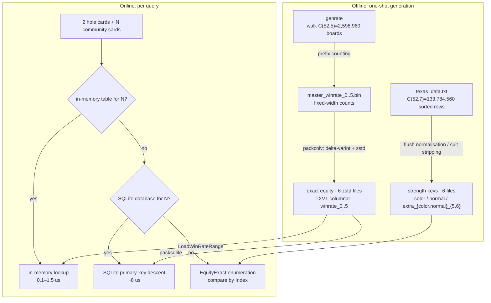
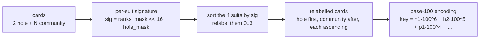
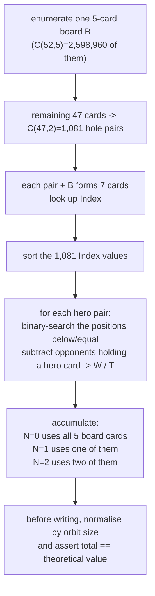

# Texas Hold'em Algorithm

[](https://github.com/esrrhs/texas_algorithm)
[](https://github.com/esrrhs/texas_algorithm)
[](https://central.sonatype.com/artifact/com.github.esrrhs/texas_algorithm)
[](https://github.com/esrrhs/texas_algorithm/actions)
[](https://github.com/esrrhs/texas_algorithm/actions)
[](https://github.com/esrrhs/texas_algorithm/actions)

[中文文档](README_CN.md)

A high-performance poker algorithm library for standard 52-card Texas Hold'em, implemented in **Java**, **Go** and **C++** with feature-parity APIs. It provides two independent subsystems:

| Subsystem | Data | Capability |
|-----------|------|------------|
| **Strength Lookup** | ~23.7 MB | Best 5 cards, rank and type for 5–7 cards |
| **Win Probability** | 44.9 MiB (zstd) | **Exact** 1v1 equity for 2 hole + 0–5 community cards |

## Data Package

The tables are committed directly to the repository root — there is no archive to download or unpack. The 12 files total **70,770,975 B ≈ 67.5 MiB**:

| File | Rows | Size | Purpose |
|------|------|------|---------|
| `texas_data_color.txt` | — | 14,558,394 B | flush-class strength keys |
| `texas_data_normal.txt` | — | 5,037,969 B | non-flush strength keys |
| `texas_data_extra_color_5.txt` | — | 112,960 B | 5-card flush auxiliary keys |
| `texas_data_extra_color_6.txt` | — | 1,757,927 B | 6-card flush auxiliary keys |
| `texas_data_extra_normal_5.txt` | — | 533,409 B | 5-card non-flush auxiliary keys |
| `texas_data_extra_normal_6.txt` | — | 1,738,288 B | 6-card non-flush auxiliary keys |
| `texas_data_winrate_0.zst` | 169 | 1,547 B | preflop exact counts |
| `texas_data_winrate_1.zst` | 5,083 | 38,881 B | 1 known community card exact counts |
| `texas_data_winrate_2.zst` | 93,769 | 581,464 B | 2 known community cards exact counts |
| `texas_data_winrate_3.zst` | 1,286,792 | 4,739,218 B | flop exact counts |
| `texas_data_winrate_4.zst` | 13,960,050 | 15,096,215 B | turn exact counts |
| `texas_data_winrate_5.zst` | 123,156,254 | 26,574,703 B | river exact counts |

The first six serve strength queries, the six `.zst` files serve win-probability queries, and the two groups are independent:

- With only the six strength files, `Load()` works and `LoadProbility()` reports the missing files without crashing. `getHandProbability` still enumerates every level on the fly (there is no table to find).
- With only the six win-rate files, table lookups work, but strength queries and on-the-fly enumeration do not (they need `Index`).

The `.zst` files are **TXV1 columnar** payloads: three separate columns (key delta-varints, then `win`, then `tie`) compressed with zstd, with only a 24-byte header per level. `total` is not a statistic but a theoretical constant, `C(50-N, 5-N) × 990`, stored once in the header; `loss = total - win - tie` is never written. Keys are ascending, so delta-varints plus zstd take 487 MB of decoded level-5 rows down to 25.4 MiB. Nothing needs manual decompression: the loaders decode the zstd stream on demand.

All loaders resolve the tables from the **current working directory**, so either run from the repository root or symlink the files into your own directory:

```bash
ln -s /path/to/texas_algorithm/texas_data_*.* .
```

### Loading Modes

All three bindings answer an equity query from the first source available for that level: **in-memory table → packed SQLite database → on-the-fly enumeration**. The public query entry point is `GetHandProbability(cards)` / `getHandProbability(hand, pub)`.

**1. SQLite — the zero-configuration mode.** The packed database is queried with a primary-key descent; rows stay on disk apart from SQLite's page cache.

```go
ta.Load()                                     // strength keys, needed by the rest of the API
ta.LoadSqlite("texas_data_winrate.db", 0, 5)  // levels 0–5 from disk
```

```java
TexasAlgorithmUtil.load();
TexasAlgorithmUtil.loadSqlite(new File("texas_data_winrate.db"), 0, 5);
```

```cpp
Load();
LoadSqlite("texas_data_winrate.db", 0, 5);
```

The database is **not in git** (2.34 GiB, about 53× the zstd files, beyond any sane repository size). Generate it locally with `cd go && go run ./cmd/packsqlite -dir .. -out ../texas_data_winrate.db`, or attach it to a release. It is a clustered, index-free database (`w{n}(k INTEGER PRIMARY KEY, w INTEGER, t INTEGER) WITHOUT ROWID`), so a lookup costs one b-tree descent.

**2. Large memory — fastest lookups.** Decode every level into compact arrays (keys `int64`, win/tie `uint32`; levels 4–5 use the same sorted arrays with binary search, never a map):

```go
ta.LoadWinRateRange(0, 5)   // +2.1 GiB RSS, 0.1–1.5 µs per query
```

Java: `TexasAlgorithmUtil.loadWinRateRange(0, 5)`; C++: `LoadWinRateRange(0, 5)`.

**3. Small memory — tables only where they pay off.** Load the lower levels and enumerate 3–5 on the fly:

```go
ta.LoadWinRateRange(0, 2)   // +1.2 MB RSS; N=3 ~46 ms, N=4 ~2 ms, N=5 ~0.2 ms
```

Measured on an Apple M1 Pro (Go 1.27.3, clean process, strength keys loaded first, median of 100 random situations per level):

| Mode | API | CPU: N=3 / N=5 | RSS (delta) | Disk |
|------|-----|-----------------|-------------|------|
| SQLite | `LoadSqlite(db, 0, 5)` | 8.2 µs / 8.2 µs | +5.4 MB | 2.34 GiB `.db` + 44.9 MiB `.zst` |
| Large memory | `LoadWinRateRange(0, 5)` | 0.7 µs / 1.5 µs | +2.1 GiB (level 5 alone 1.88 GiB) | 44.9 MiB `.zst` |
| Small memory | `LoadWinRateRange(0, 2)` | 45.8 ms / 207 µs | +1.2 MB | 44.9 MiB `.zst` |

Per-level SQLite lookup latency (median): 4.5 / 4.6 / 8.0 / 8.2 / 10.0 / 8.2 µs for N = 0…5. The SQLite mode buys RAM and load time, not disk space: its file is an order of magnitude larger than the zstd data. The database dependencies are: Go `modernc.org/sqlite` (pure Go, no cgo), C++ the system `libsqlite3` or a CMake-fetched amalgamation (see [SQLite (optional)](#sqlite-optional)), Java `org.xerial:sqlite-jdbc` (about 13 MB with native libraries for every platform, downloaded once by Maven and extracted at runtime). None of them breaks "clone and build": a C++ build without any SQLite simply disables that mode.

Defaults stay conservative: `LoadProbility()` loads levels 0–3 only. Levels 4 and 5 are never decoded unless you ask for them by range or open the database, because decoded they need 223 MiB and 1.88 GiB.

---

## Project Layout

```
java/    Java implementation (Maven, published to Maven Central)
go/      Go implementation (feature-aligned port of the Java library)
cpp/     C++ implementation (feature-aligned port, CMake build)
```

All implementations share the same data tables and produce bit-identical results.

---

## Java

### Maven Dependency

```xml
<dependency>
    <groupId>com.github.esrrhs</groupId>
    <artifactId>texas_algorithm</artifactId>
    <version>1.0.14</version>
</dependency>
```

### Quick Start

```java
// 1. Strength keys (~23.7 MB, required for evaluation and on-the-fly enumeration)
TexasAlgorithmUtil.load();

// 2. Exact win-rate tables for levels 0–3 (~5.1 MB of zstd); levels 4–5 keep
//    enumerating unless you load them or open the packed SQLite database
TexasAlgorithmUtil.loadProbility();

// 3. Best 5-card hand
String best = TexasAlgorithmUtil.getMax("黑2,黑3", "方2,方A,黑7,黑5,红10");

// 4. Absolute rank and direct comparison (higher is stronger; positive means str1 wins)
int rank = TexasAlgorithmUtil.getWinPosition("方4,方A,红7,黑A,黑3,黑5,黑6");
int cmp  = TexasAlgorithmUtil.compare("方4,方A,红7,黑A,黑3,黑5,黑6",
                                      "黑2,红3,方7,梅9,方K,黑Q,红J");

// 5. Hand type constant
int type = TexasAlgorithmUtil.getWinType("方4,方A,红7,黑A,黑3,黑5,黑6");

// 6. Exact 1v1 equity, returns a float in [0, 1]
float p = TexasAlgorithmUtil.getHandProbability("方3,黑6", "黑2,黑4,黑5,黑K");
```

All card-taking methods validate the 52-card encoding; illegal cards (for example a color above 3 or a value outside 2..14) throw `IllegalArgumentException`.

---

## Go

### Installation

```bash
go get github.com/esrrhs/texas_algorithm/go
```

### Quick Start

```go
package main

import (
	"fmt"

	ta "github.com/esrrhs/texas_algorithm/go"
)

func main() {
	// Strength keys (~23.7 MB)
	ta.Load()

	// Exact win-rate tables for levels 0–3 (~5.1 MB of zstd)
	ta.LoadProbility()

	best, err := ta.GetMaxStrHandPub("黑2,黑3", "方2,方A,黑7,黑5,红10")
	if err != nil {
		panic(err)
	}
	fmt.Println(best)

	rank, _ := ta.GetWinPositionStr("方4,方A,红7,黑A,黑3,黑5,黑6")
	cmp, _ := ta.CompareStr("方4,方A,红7,黑A,黑3,黑5,黑6",
		"黑2,红3,方7,梅9,方K,黑Q,红J")
	typ, _ := ta.GetWinTypeStr("方4,方A,红7,黑A,黑3,黑5,黑6")

	p, err := ta.GetHandProbabilityStr("方3,黑6", "黑2,黑4,黑5,黑K")
	if err != nil {
		panic(err)
	}

	_, _, _, _ = rank, cmp, typ, p
}
```

The Go API mirrors the Java one: `Load`/`LoadDir` ↔ `load()`, `GetKeyData*` ↔ `getKeyData()`, `GetMax*` ↔ `getMax()`, `GetWin*` ↔ `getWin*()`, `Compare*` ↔ `compare()`, `GetHandProbability*` ↔ `getHandProbability()`. Illegal cards return an `error` wrapping `ErrUnknownPoke`. A missing win-rate table is not an error: the query enumerates on the fly, which requires `Load()`.

---

## C++

### Build

```bash
cd cpp
cmake -S . -B build -DCMAKE_BUILD_TYPE=Release
cmake --build build --parallel
```

Requires a C++17 compiler and CMake 3.16+.

### SQLite (optional)

SQLite is only needed to query the packed `.db`; everything else builds without it. `-DTEXAS_SQLITE=<mode>` picks how CMake obtains it:

| Mode | Behaviour |
|------|-----------|
| `auto` (default) | use the system SQLite if found, otherwise download the pinned 3.45.1 amalgamation |
| `system` | system SQLite only; when it is missing, SQLite support is turned off |
| `fetch` | always download the pinned amalgamation |
| `off` | no SQLite support |

The download is pinned to `sqlite-amalgamation-3450100.zip` with a fixed SHA256 and cached under the build tree (`_deps/`), so the **first configure needs network access only when no system library is found**. Offline or sandboxed builds either install a system library (`apt install libsqlite3-dev`, `brew install sqlite`) or pass `-DTEXAS_SQLITE=off`.

A build without SQLite never fails: `LoadSqlite` still links, prints `本构建未启用 SQLite 支持，请用 -DTEXAS_SQLITE=fetch 重新配置` and returns false, so every query falls back to enumeration. `IsSqliteSupported()` reports which kind of build you have.

### Quick Start

```cpp
#include "texas_algorithm_util.h"

using namespace texas_algorithm;

int main()
{
    Load();            // strength keys (~23.7 MB)
    LoadProbility();   // exact win-rate tables for levels 0–3 (~5.1 MB of zstd)

    std::string best = GetMaxStrHandPub("黑2,黑3", "方2,方A,黑7,黑5,红10");
    int rank = GetWinPositionStr("方4,方A,红7,黑A,黑3,黑5,黑6");
    int cmp  = CompareStr("方4,方A,红7,黑A,黑3,黑5,黑6",
                          "黑2,红3,方7,梅9,方K,黑Q,红J");
    int type = GetWinTypeStr("方4,方A,红7,黑A,黑3,黑5,黑6");

    float p = GetHandProbabilityStr("方3,黑6", "黑2,黑4,黑5,黑K");
}
```

Link against the `texas_algorithm` library target. Illegal cards throw `std::invalid_argument`; a missing win-rate table is not an error, the query enumerates on the fly (which requires `Load()`).

---

## Card Notation

Cards are expressed as Chinese-character strings separated by commas.

### Suits

| Notation | Suit | English |
|----------|------|---------|
| `方` | ♦ | Diamond |
| `梅` | ♣ | Club |
| `红` | ♥ | Heart |
| `黑` | ♠ | Spade |

### Values

`2` `3` `4` `5` `6` `7` `8` `9` `10` `J` `Q` `K` `A`

Each card is encoded as a single byte `(color << 4) | value`: `color` is 0..3 (`方`=0, `梅`=1, `红`=2, `黑`=3) and `value` is 2..14 (`J`=11, `Q`=12, `K`=13, `A`=14). The deck has 52 cards; any other byte is rejected.

---

## Hand Types

The `getWinType()` method returns one of these constants (Go: `TexasCardType*` in the `go` package, C++: `TexasCardType*` in the `texas_algorithm` namespace — same values):

| Constant | Value | Hand |
|----------|-------|------|
| `TEXAS_CARD_TYPE_GAOPAI` | 1 | High Card |
| `TEXAS_CARD_TYPE_DUIZI` | 2 | One Pair |
| `TEXAS_CARD_TYPE_LIANGDUI` | 3 | Two Pair |
| `TEXAS_CARD_TYPE_SANTIAO` | 4 | Three of a Kind |
| `TEXAS_CARD_TYPE_SHUNZI` | 5 | Straight |
| `TEXAS_CARD_TYPE_TONGHUA` | 6 | Flush |
| `TEXAS_CARD_TYPE_HULU` | 7 | Full House |
| `TEXAS_CARD_TYPE_SITIAO` | 8 | Four of a Kind |
| `TEXAS_CARD_TYPE_TONGHUASHUN` | 9 | Straight Flush |
| `TEXAS_CARD_TYPE_KINGTONGHUASHUN` | 10 | Royal Flush |

---

## API Reference

### `TexasAlgorithmUtil` (Java)

```java
// Load / initialise
void load()                                   // load strength keys (current directory)
void load(String dirPath)                     // load strength keys from a directory
void load(File dir)
void loadProbility()                          // load win-rate levels 0–3 (current directory)
void loadProbility(String dirPath)
void loadProbility(File dir)
void loadProbilityAll(File dir)               // load all six levels (about 2.1 GiB)
void loadWinRateRange(int from, int to)       // load levels from..to into memory
void loadWinRateRange(File dir, int from, int to)
void loadSqlite(File db, int from, int to)    // query levels from..to on demand
boolean isLoaded()                            // strength keys loaded
boolean isProbabilityLoaded()                 // loaded win-rate levels present

// Best hand
String getMax(String hand, String pub)        // best 5 of 2 hole + 3–5 community
String getMax(String cards)                   // best 5 of a 5–7 card list

// Hand evaluation (requires load())
int    getWinPosition(String cards)           // absolute rank
double getWinProbability(String cards)        // win ratio vs. all same-size combinations
int    getWinType(String cards)               // hand type constant
long   getWinMax(String cards)                // encoded key of the best 5-card hand
int    compare(String str1, String str2)      // compare two 7-card hands

// Exact equity: in-memory table → SQLite → enumeration; requires load() for
// the enumeration fallback
float  getHandProbability(String hand, String pub)
```

### Go / C++ equivalents

| Java | Go / C++ |
|------|----------|
| `load()` / `load(dir)` | `Load()` / `LoadDir(dir)` |
| `loadProbility()` / `loadProbility(dir)` | `LoadProbility()` / `LoadProbilityDir(dir)` |
| `loadProbilityAll(dir)` | `LoadProbilityAll(dir)` |
| `loadWinRateRange(from, to)` | `LoadWinRateRange(from, to)` |
| `loadWinRateRange(dir, from, to)` | `LoadWinRateRangeDir(dir, from, to)` |
| `loadSqlite(db, from, to)` | `LoadSqlite(path, from, to)` |
| `isLoaded()` / `isProbabilityLoaded()` | `IsLoaded()` / `IsProbabilityLoaded()` |
| `getMax(hand, pub)` | `GetMaxStrHandPub(hand, pub)` |
| `getMax(cards)` | `GetMaxStr(cards)` / `GetMax(pokes)` |
| `getWinPosition(cards)` | `GetWinPositionStr(cards)` / `GetWinPosition(pokes)` |
| `getWinProbability(cards)` | `GetWinProbabilityStr(cards)` / `GetWinProbability(pokes)` |
| `getWinType(cards)` | `GetWinTypeStr(cards)` / `GetWinType(pokes)` |
| `getWinMax(cards)` | `GetWinMaxStr(cards)` / `GetWinMax(pokes)` |
| `compare(str1, str2)` | `CompareStr(str1, str2)` / `CompareBytes(a, b)` / `CompareKey(k1, k2)` |
| `getHandProbability(hand, pub)` | `GetHandProbabilityStr(hand, pub)` / `GetHandProbability(hand, pub)` |

---

## Running Unit Tests

```bash
# Java: JUnit 5 (Java 8, 11, 17, 21)
cd java && mvn test

# Go
cd go && go test ./...

# C++ (CMake/ctest)
cd cpp && cmake -S . -B build && cmake --build build && ctest --test-dir build --output-on-failure
```

Tests that need the data tables skip gracefully when the files are absent. The SQLite tests additionally skip unless the locally generated `texas_data_winrate.db` exists (it is not committed).

---

## Regenerating the Data Tables

Strength keys and exact equity tables come from two independent pipelines.

### 1. Strength keys

1. Make sure the data tables are in the working directory (they ship in the repository root; run from the root, or symlink them into your directory).
2. Java: run `TexasAlgorithmUtil.main()` with `-Xmx8000m` (~8 GB heap); Go: `go run ./cmd/texas_algorithm` in `go/`; C++: `./build/texas_algorithm_demo` in `cpp/`.
3. Takes roughly **7–8 hours** on a 10-core machine.

### 2. Exact win-rate tables

```bash
cd go
# 1. Walk the boards and write master_winrate_N.bin (fixed-width, 16 B per row)
go run ./cmd/genrate -workers 10 -ckpt genrate.ckpt -out .

# 2. Encode masters as TXV1 columnar payloads and compress with zstd
go run ./cmd/packcolv -dir ..

# 3. Optional: pack the six levels into one on-demand SQLite database
go run ./cmd/packsqlite -dir .. -out ../texas_data_winrate.db

# 4. Optional: cross-check that the six tables are complete (counts keys, ignores win/tie)
go run ./cmd/genrate -mode expect -maxN 5 -out ..
```

- `-workers`: concurrency, defaults to `NumCPU`
- `-ckpt`: checkpoint file; it carries a version tag, so a checkpoint written by a different version is ignored
- `-resume=false`: ignore an existing checkpoint
- `-mode smoke` / `-maxE`: small self-check runs
- `-mode count`: only decodes the `.zst` files and counts rows, so it **cannot catch keys dropped during generation**
- `-mode expect`: derives how many keys each level must hold and compares that with the decoded row count, reporting which level, the expected count and the actual count on a mismatch.
  - levels 0-4 use **brute-force card enumeration plus dedupe** (canonicalise with `CanonKey`, count distinct keys in a set): levels 0-2 take well under a second, level 3 about 3 s, level 4 about a minute and 390 MB (the default `-bruteN 4`; `-bruteN 3` takes about 6 s)
  - level 5 (123M keys over 2.8B situations) uses a **closed-form Burnside count over the multiset of suit signatures** by default, which takes milliseconds; full brute force (`-bruteN 5`) measured about 20 minutes with a 5.7 GB peak RSS
  - what it proves: the table holds exactly the keys it should, none missing and none extra; the formula also agrees with brute force on levels 0-5
  - what it does not prove: that the key definition itself is right, since both derivations assume it — and it says nothing about the win/tie values or the totals

Apple M1 Pro (10 cores), 10 workers: **18m04s**, about 3.0 CPU-hours. `packcolv` reads each master once per column, so level 5 packs in a flat heap. `packsqlite` is resumable at level granularity and writes `texas_data_winrate.db.tmp` before atomically renaming it, so a crash never leaves a usable-looking half database; the same inputs produce byte-identical output.

---

## Algorithm Details

### Overview



In one sentence: **the strength tables answer "how strong is this hand", the equity tables answer "how often does this board win"; the former underpins the latter, and the latter covers all streets when asked to, but only preflop through the flop by default.**

---

### Part 1 — Offline

#### 1.1 Strength key tables (`color` / `normal` / `extra_*`)

**Question**: given 5–7 cards, where does the best 5-card hand rank among all combinations of the same size?

**How it is built**:

1. Enumerate all C(52,7) = 133,784,560 seven-card combinations, each identified by an encoded key.
2. Sort by hand strength, producing `Index` (rank order), `Max` (key of the best 5 cards) and `Type`.
3. Storing 133 million rows would not fit in memory, so suit redundancy is stripped:
   - **Flush classes** (flush, straight flush, royal flush): at least five cards share a suit; the suit distribution is normalised to `♦♦♦♦♦♣♠` and written to `texas_data_color.txt`.
   - **Non-flush classes**: suits do not affect strength, so all suits collapse to `♦`, written to `texas_data_normal.txt`.
   - `extra_{color,normal}_{5,6}` are the same kind of tables for the 5- and 6-card scales.
4. A query looks up both tables and keeps the higher rank.

This step is independent of equity; it supplies the `Index` used by the equity enumeration.

#### 1.2 Exact equity tables (`winrate_0` … `winrate_5`)

**What is stored**: the full enumeration count of every "2 hole cards + N known community cards" situation (N = 0…5) against one random opponent:

```
<key> <win> <tie>        (total lives once in the header)
```

- `key`: the suit-canonical key (see 1.3)
- `win` / `tie`: number of opponent hands the hero strictly beats / ties
- `total`: enumeration count of that situation, equal to `C(50-N, 5-N) × 990`

`total` is not a variable statistic but a **theoretical constant**, so it is stored once per file instead of once per row, and `loss = total - win - tie` is never written:

| Table | Rows | total per row | Value |
|-------|------|---------------|-------|
| `winrate_0` | 169 | C(50,5) × 990 | 2,097,572,400 |
| `winrate_1` | 5,083 | C(49,4) × 990 | 209,757,240 |
| `winrate_2` | 93,769 | C(48,3) × 990 | 17,123,040 |
| `winrate_3` | 1,286,792 | C(47,2) × 990 | 1,070,190 |
| `winrate_4` | 13,960,050 | C(46,1) × 990 | 45,540 |
| `winrate_5` | 123,156,254 | C(45,0) × 990 | 990 |

**Encoding**: TXV1 is columnar, not row-oriented. After a 24-byte header (`"TXV1"`, level, row count, total) each file holds three separate column streams — key delta-varints, then every `win`, then every `tie` — and the whole payload is compressed with zstd. Keys are ascending by construction, so deltas are small; the 487 MB of decoded level-5 rows compress to 25.4 MiB. The decoder is built into all three bindings (Go `klauspost/compress/zstd`, vendored zstd decompression-only C library, Java aircompressor), so users never unpack anything by hand.

#### 1.3 Key encoding: suit-permutation reduction and role separation

A card is `(suit << 4) | rank`. The key is built in three steps:



- **Signature** `sig = ranks_mask << 16 | hole_mask`: which ranks appear in that suit, and which of them are hole cards.
- **Relabel by signature**: under any suit permutation the multiset of the four signatures is unchanged, so the sorted relabelling differs only in the order of suits that share a signature. But suits sharing a signature hold exactly the same `(rank, role)` pairs, so swapping them does not change the relabelled card set — the key is unique.
- **Hole cards first, community after**: `hole_mask` participates in the signature, and the two roles occupy different key positions, so "A♠K♠ hole + Q♠ board" and "A♠ hole + K♠Q♠ board" never collide.

#### 1.4 Why the reduction is exact, not approximate

The key fact: **a global suit relabelling is an automorphism of the game** — it preserves every card's rank and the "same suit or not" equivalence, so the strength of any 7-card hand and the winner between any two hands are unchanged.

Therefore:

- Every physical situation in one orbit has **exactly** the same W/T/L (bit-identical, not merely close).
- `CanonKey` is a complete invariant of the orbit: two situations share a key iff they are in the same orbit.
- Aggregating by key therefore adds the same numbers `|orbit|` times and divides them back out; the result is identical to enumerating each situation separately.

The generator turns this into an assertion instead of a promise:

```go
mult := v.N / base[n]              // orbit size
if v.W%mult != 0 || v.T%mult != 0 { // must be uniform inside an orbit
    panic("counts are not orbit-uniform")
}
```

If an orbit is not uniform, or any board was skipped, `v.N % base[n] != 0` panics immediately.

#### 1.5 Where the row counts come from

| Table | Physical situations | Orbits (= rows) | Compression |
|-------|--------------------|-----------------|-------------|
| N = 0 | C(52,2) = 1,326 | **169** | 7.8× |
| N = 1 | 1,326 × 50 = 66,300 | **5,083** | 13.0× |
| N = 2 | 1,326 × C(50,2) = 1,624,350 | **93,769** | 17.3× |
| N = 3 | 1,326 × C(50,3) = 25,989,600 | **1,286,792** | 20.2× |
| N = 4 | 1,326 × C(50,4) = 305,377,800 | **13,960,050** | 21.9× |
| N = 5 | 1,326 × C(50,5) = 2,809,475,760 | **123,156,254** | 22.8× |

- **169** has a closed form: 13 pairs + 78 suited + 78 offsuit, the classic number of starting hands.
- The rest are the orbit counts of `(2 hole + N board)` under the 24-element suit group. There is no simple closed form; they equal the number of distinct `CanonKey` values the generator emits, and can be checked directly against the output row count.

#### 1.6 Generator: one pass, prefix counting

The naive approach — every situation × every board completion × 990 opponents — is about 2.8×10¹² comparisons and not viable. The generator inverts the loop order:



With hero cards `i, j`, the opponent must be two of the remaining 45 cards, i.e. **C(45,2) = 990**. Let `lo` / `hi` be the positions of the first `Index < hero` and first `Index > hero`, and let `la` / `lb` count opponents containing card `i` / `j` below the hero, `ea` / `eb` the equal ones. Then:

```
win  = lo - la - lb
tie  = (hi - lo) - (ea + eb - 1)   // -1 is the hero pair itself, counted in both per-card lists
loss = 990 - win - tie
```

This is precisely where opponent combinations containing exactly one hero card are excluded from the denominator.

**Why one pass fills six tables**: a 5-card board `B` is simultaneously every prefix of it — the full board for N=0, one of the five 1-card prefixes for N=1, and so on down to the five-card board itself for N=5. The prefixes are exactly the `C(5,N)` subsets, so each of the 1,081 hero pairs is accumulated `2^5 = 32` times across the six tables: `Σ C(5,N) = 1 + 5 + 10 + 10 + 5 + 1 = 32`. After all 2,598,960 × 1,081 board/pair combinations, all six tables are complete.

**Engineering details**:

- **Parallel**: work is split by the largest card index `e`; `-workers` sets concurrency, each worker accumulates locally and merges.
- **Resumable**: after each `e`, a gob checkpoint with `ckptVer` is written; a checkpoint with a different version is ignored.
- **Deterministic**: merging is integer addition (commutative) and output is sorted by key, so worker scheduling cannot change the bytes (verified with sha256).
- **Observable**: every `e` prints completed boards, percentage and ETA.

#### 1.7 Cost and output

| Item | Value |
|------|-------|
| Work | 2,598,960 boards × 1,081 hole pairs |
| Wall clock (M1 Pro, 10 workers) | 18m04s (~3.0 CPU-hours) |
| Decoded level-5 payload | 487,590,054 B |
| `winrate_0.zst` | 169 rows / 1,547 B |
| `winrate_1.zst` | 5,083 rows / 38,881 B |
| `winrate_2.zst` | 93,769 rows / 581,464 B |
| `winrate_3.zst` | 1,286,792 rows / 4,739,218 B |
| `winrate_4.zst` | 13,960,050 rows / 15,096,215 B |
| `winrate_5.zst` | 123,156,254 rows / 26,574,703 B |
| Total on disk | 47,025,828 B ≈ 44.9 MiB |

#### 1.8 Verification

1. **Structural assertion**: every row's `total` must equal the theoretical enumeration count, otherwise the generator panics (catches skipped boards and stale checkpoints).
2. **Uniformity assertion**: `W % orbit == 0 && T % orbit == 0` (catches a wrong orbit reduction).
3. **Independent brute force**: a separate enumerator that never uses `Index` and compares hand strength pairwise. Random samples — 200 at N=2, 3 at N=1, 1 at N=0 — match the tables bit-for-bit as float32.
4. **Cross-language**: Go and C++ agree bit-for-bit on all 13 validation cases covering N=0..5.

---

### Part 2 — Online

#### 2.1 Table lookup (default for N ≤ 3, optional for 4–5)

```text
key = CanonKey(hole ++ community, nHole = 2)
row = WinRateMap[N][key]          // or the packed SQLite database
P   = (2·win + tie) / (2·total)
```

`LoadProbility()` loads levels 0–3 by default; levels 4 and 5, or any level in a packed database, enter the same code path once loaded. The in-memory store is a sorted key array plus parallel `win`/`tie` arrays (binary search, never a map); the SQLite store is a `WITHOUT ROWID` primary-key descent. Measured median per query: **0.1–0.7 µs** in memory, **4.5–10 µs** from SQLite.

#### 2.2 Enumeration (default for N ≥ 4)

When no table and no database cover a level, `EquityExact` enumerates every remaining board completion × 990 opponents:

| N | Board completions | Opponents | Comparisons | Latency (M1 Pro) |
|---|-------------------|-----------|-------------|------------------|
| 3 (flop) | C(47,2) = 1,081 | 990 | 1,070,190 | 45.8 ms (multi-threaded) |
| 4 (turn) | C(46,1) = 46 | 990 | 45,540 | 2.0 ms (multi-threaded) |
| 5 (river) | 1 | 990 | 990 | 207 µs (single-threaded) |

Comparison uses the `Index` of the strength tables rather than re-evaluating hand types: larger `Index` wins, equal means a tie.

#### 2.3 Where 990 comes from

Once the hero holds two cards, the opponent can only draw from the remaining 50 — but the 91 combinations containing a hero card are illegal (`46 + 46 - 1`), so:

```
C(50,2) - 91 = 1225 - 91 = 990 = C(45,2)
```

Board completion consumes more cards during enumeration, but the rule stays the same: the opponent draws two of the 45 cards left after removing the hero's cards and all known community cards. Hence 990 at every stage.

#### 2.4 Ties count as half a win

```text
P(win) = (W + 0.5·T) / (W + T + L) = (2W + T) / (2(W + T + L))
```

The implementation keeps integer counts throughout and rounds `float64 → float32` once at the end: at most 1 ulp (< 1.2×10⁻⁷ relative), with no accumulated error.

#### 2.5 Why the default cut-off sits at 3

The tables exist for every level and are exact, but each extra level multiplies both the build cost and the resident memory:

| N | Orbits (= rows) | Decoded rows at 16 B (keys int64 + win/tie uint32) | Comparisons to build |
|---|-----------------|-----------------------------------------------------|----------------------|
| 3 | 1,286,792 | ~21 MB | 2.6×10⁷ situations × 1,070,190 ≈ 2.8×10¹³ |
| 4 | 13,960,050 | ~223 MB | 3.1×10⁸ × 45,540 ≈ 1.4×10¹³ |
| 5 | 123,156,254 | ~1.88 GiB | 2.8×10⁹ × 990 ≈ 2.8×10¹² |

At 50 ns per comparison an N=4 table costs days of CPU to build, while the same N=4 situation is answered in 2.0 ms by enumeration. **Precomputing is orders of magnitude more expensive than computing, and the extra 2 GB would be resident forever**, so the default is to load 0–3 only. The upper streets remain available: `LoadWinRateRange(0, 5)` puts them in memory when a workload is river-heavy, and `LoadSqlite(db, 0, 5)` answers them in ~8 µs while keeping the heap flat.

---

### Part 3 — Cross-language consistency

| Item | Go | C++ | Java |
|------|----|-----|------|
| Exact algorithm | ✅ tests run | ✅ tests run | ✅ `mvn test` 12/12 |
| Table format / CanonKey | ✅ | ✅ | ✅ |
| SQLite path | ✅ tested against the packed DB | ✅ tested against the packed DB | ✅ tested against the packed DB |
| Error and latency data | ✅ measured | reuses Go's tables and algorithm | reuses Go's tables and algorithm |

The Go, C++ and Java suites all cover N=0..5, the in-memory tables, the SQLite fallback and its range limiting. The SQLite cases need the locally generated `texas_data_winrate.db` and skip when it is absent; CI can generate it once or attach it as a build artifact.

---

## Related Projects

- [majiang_algorithm](https://github.com/esrrhs/majiang_algorithm) — Mahjong algorithm
- [teenpatti_algorithm](https://github.com/esrrhs/teenpatti_algorithm) — Teen Patti (Indian poker) algorithm
