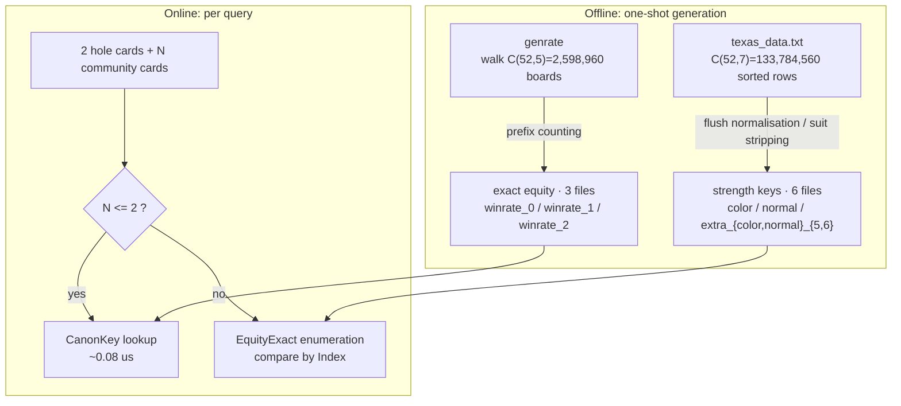
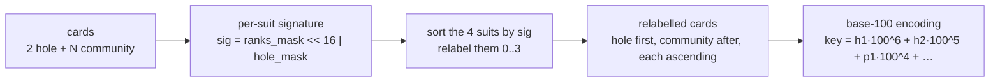
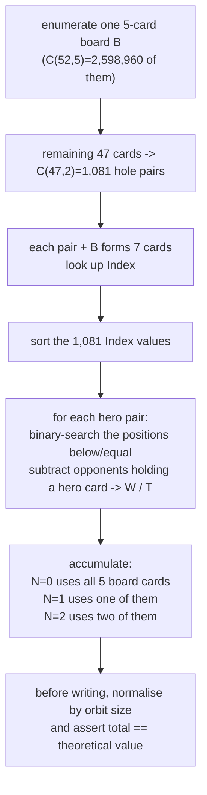

# Texas Hold'em Algorithm

[](https://github.com/esrrhs/texas_algorithm)
[](https://github.com/esrrhs/texas_algorithm)
[](https://central.sonatype.com/artifact/com.github.esrrhs/texas_algorithm)
[](https://github.com/esrrhs/texas_algorithm/actions)
[](https://github.com/esrrhs/texas_algorithm/actions)
[](https://github.com/esrrhs/texas_algorithm/actions)

[中文文档](README_CN.md)

A high-performance poker algorithm library for standard 52-card Texas Hold'em, implemented in **Java**, **Go** and **C++** with feature-parity APIs. It provides two independent subsystems:

| Subsystem | Memory | Capability |
|-----------|--------|------------|
| **Strength Lookup** | ~20 MB | Best 5 cards, rank and type for 5–7 cards |
| **Win Probability** | ~4.7 MB | **Exact** 1v1 equity for 2 hole + 0–5 community cards |

## Breaking Changes (54 → 52 Cards)

Joker / wild-card support has been removed. Code written against the previous 54-card API needs the following changes:

- **Joker input is rejected.** The deck is the standard 52 cards. The joker card (`鬼`, byte 88 / color 5) and the `"鬼"` string branch were removed; inputs such as `"鬼"` or the raw byte 88 now fail validation. Legal cards are color 0..3 and value 2..14.
- **No more joker-substitution value.** `getMax` / `getMaxStrHandPub` / `getMaxHandPub` no longer return or accept a second `guiTrans` value: Go returns `(best, error)`, Java and C++ return only the best hand. The `FiveFromSeven` / `FiveFromSix` / `FiveFromFive` joker wrappers are gone; only the `...WithoutGui` core functions remain.
- **Illegal input now errors instead of returning a zero value.** `getKeyData`, `getWinPosition`, `getWinProbability`, `getWinMax`, `getWinType`, `compare*` and `getHandProbability` reject illegal cards: Go returns an `error` (`ErrUnknownPoke`, message starting with `无法识别的牌`), Java throws `IllegalArgumentException`, C++ throws `std::invalid_argument`.
- **Tables regenerated for C(52,7) = 133,784,560.** The strength tables now enumerate 7-card combinations out of 52 cards instead of C(54,7).
- **The legacy interpolation tables `texas_data_opt_2..6.txt` are gone.** Exact equity is served by `texas_data_winrate_0..2.txt`, and `GetHandProbabilityKey` (Java: `getHandProbability(long)`) was removed with it. The data package shrinks from 11 files to 9 and from 348.4 MiB to 25.8 MiB.

## Data Package

The tables are committed directly to the repository root — there is no archive to download or unpack. The 9 files total **27,051,640 B ≈ 25.8 MiB**:

| File | Rows | Size | Purpose |
|------|------|------|---------|
| `texas_data_color.txt` | — | 14,558,394 B | flush-class strength keys |
| `texas_data_normal.txt` | — | 5,037,969 B | non-flush strength keys |
| `texas_data_extra_color_5.txt` | — | 112,960 B | 5-card flush auxiliary keys |
| `texas_data_extra_color_6.txt` | — | 1,757,927 B | 6-card flush auxiliary keys |
| `texas_data_extra_normal_5.txt` | — | 533,409 B | 5-card non-flush auxiliary keys |
| `texas_data_extra_normal_6.txt` | — | 1,738,288 B | 6-card non-flush auxiliary keys |
| `texas_data_winrate_0.txt` | 169 | 6,060 B | preflop exact counts |
| `texas_data_winrate_1.txt` | 5,083 | 176,806 B | 1 known community card exact counts |
| `texas_data_winrate_2.txt` | 93,769 | 3,129,827 B | 2 known community cards exact counts |

The first six serve strength queries, the last three serve win-probability queries, and the two groups are independent:

- With only the six strength files, `Load()` works and `LoadProbility()` reports the missing files without crashing. `getHandProbability` still enumerates N ≥ 3 on the fly and reports "missing win-rate data" for N ≤ 2.
- With only the three win-rate files, equity lookups work, but strength queries and on-the-fly enumeration do not (they need `Index`).

All loaders resolve the tables from the **current working directory**, so either run from the repository root or symlink the files into your own directory:

```bash
ln -s /path/to/texas_algorithm/texas_data_*.txt .
```

If repository size matters on your clone, keep them gzipped locally (`gzip -9 texas_data_*.txt` shrinks the set to ≈ 3.0 MiB) and decompress only when you need to run the tables.

---

## Project Layout

```
java/    Java implementation (Maven, published to Maven Central)
go/      Go implementation (feature-aligned port of the Java library)
cpp/     C++ implementation (feature-aligned port, CMake build)
```

All implementations share the same data tables and produce bit-identical results; Go and C++ were verified against Java with bit-level output comparison.

---

## Java

### Maven Dependency

```xml
<dependency>
    <groupId>com.github.esrrhs</groupId>
    <artifactId>texas_algorithm</artifactId>
    <version>1.0.14</version>
</dependency>
```

### Quick Start

```java
// 1. Strength keys (~20 MB, required for evaluation and on-the-fly enumeration)
TexasAlgorithmUtil.load();

// 2. Exact win-rate tables (~4.7 MB, only the N <= 2 lookups need them)
TexasAlgorithmUtil.loadProbility();

// 3. Best 5-card hand
String best = TexasAlgorithmUtil.getMax("黑2,黑3", "方2,方A,黑7,黑5,红10");

// 4. Absolute rank and direct comparison (higher is stronger; positive means str1 wins)
int rank = TexasAlgorithmUtil.getWinPosition("方4,方A,红7,黑A,黑3,黑5,黑6");
int cmp  = TexasAlgorithmUtil.compare("方4,方A,红7,黑A,黑3,黑5,黑6",
                                      "黑2,红3,方7,梅9,方K,黑Q,红J");

// 5. Hand type constant
int type = TexasAlgorithmUtil.getWinType("方4,方A,红7,黑A,黑3,黑5,黑6");

// 6. Exact 1v1 equity, returns a float in [0, 1]
float p = TexasAlgorithmUtil.getHandProbability("方3,黑6", "黑2,黑4,黑5,黑K");
```

All card-taking methods validate the 52-card encoding; illegal cards (for example `鬼`, byte 88, color above 3 or value outside 2..14) throw `IllegalArgumentException`.

---

## Go

### Installation

```bash
go get github.com/esrrhs/texas_algorithm/go
```

### Quick Start

```go
package main

import (
	"fmt"

	ta "github.com/esrrhs/texas_algorithm/go"
)

func main() {
	// Strength keys (~20 MB)
	ta.Load()

	// Exact win-rate tables (~4.7 MB)
	ta.LoadProbility()

	best, err := ta.GetMaxStrHandPub("黑2,黑3", "方2,方A,黑7,黑5,红10")
	if err != nil {
		panic(err)
	}
	fmt.Println(best)

	rank, _ := ta.GetWinPositionStr("方4,方A,红7,黑A,黑3,黑5,黑6")
	cmp, _ := ta.CompareStr("方4,方A,红7,黑A,黑3,黑5,黑6",
		"黑2,红3,方7,梅9,方K,黑Q,红J")
	typ, _ := ta.GetWinTypeStr("方4,方A,红7,黑A,黑3,黑5,黑6")

	p, err := ta.GetHandProbabilityStr("方3,黑6", "黑2,黑4,黑5,黑K")
	if err != nil {
		panic(err)
	}

	_, _, _, _ = rank, cmp, typ, p
}
```

The Go API mirrors the Java one: `Load`/`LoadDir` ↔ `load()`, `GetKeyData*` ↔ `getKeyData()`, `GetMax*` ↔ `getMax()`, `GetWin*` ↔ `getWin*()`, `Compare*` ↔ `compare()`, `GetHandProbability*` ↔ `getHandProbability()`. Illegal cards return an `error` wrapping `ErrUnknownPoke`; a missing win-rate table makes `GetHandProbability` return `ErrNoProbabilityData`.

---

## C++

### Build

```bash
cd cpp
cmake -S . -B build -DCMAKE_BUILD_TYPE=Release
cmake --build build --parallel
```

Requires a C++17 compiler and CMake 3.16+.

### Quick Start

```cpp
#include "texas_algorithm_util.h"

using namespace texas_algorithm;

int main()
{
    Load();            // strength keys (~20 MB)
    LoadProbility();   // exact win-rate tables (~4.7 MB)

    std::string best = GetMaxStrHandPub("黑2,黑3", "方2,方A,黑7,黑5,红10");
    int rank = GetWinPositionStr("方4,方A,红7,黑A,黑3,黑5,黑6");
    int cmp  = CompareStr("方4,方A,红7,黑A,黑3,黑5,黑6",
                          "黑2,红3,方7,梅9,方K,黑Q,红J");
    int type = GetWinTypeStr("方4,方A,红7,黑A,黑3,黑5,黑6");

    float p = GetHandProbabilityStr("方3,黑6", "黑2,黑4,黑5,黑K");
}
```

Link against the `texas_algorithm` library target. Illegal cards throw `std::invalid_argument`; a missing win-rate table throws `std::invalid_argument("缺少胜率表数据")`.

---

## Card Notation

Cards are expressed as Chinese-character strings separated by commas.

### Suits

| Notation | Suit | English |
|----------|------|---------|
| `方` | ♦ | Diamond |
| `梅` | ♣ | Club |
| `红` | ♥ | Heart |
| `黑` | ♠ | Spade |

### Values

`2` `3` `4` `5` `6` `7` `8` `9` `10` `J` `Q` `K` `A`

Each card is encoded as a single byte `(color << 4) | value`: `color` is 0..3 (`方`=0, `梅`=1, `红`=2, `黑`=3) and `value` is 2..14 (`J`=11, `Q`=12, `K`=13, `A`=14). The deck has 52 cards, and any other byte (including the removed joker byte 88 / color 5) is rejected.

---

## Hand Types

The `getWinType()` method returns one of these constants (Go: `TexasCardType*` in the `go` package, C++: `TexasCardType*` in the `texas_algorithm` namespace — same values):

| Constant | Value | Hand |
|----------|-------|------|
| `TEXAS_CARD_TYPE_GAOPAI` | 1 | High Card |
| `TEXAS_CARD_TYPE_DUIZI` | 2 | One Pair |
| `TEXAS_CARD_TYPE_LIANGDUI` | 3 | Two Pair |
| `TEXAS_CARD_TYPE_SANTIAO` | 4 | Three of a Kind |
| `TEXAS_CARD_TYPE_SHUNZI` | 5 | Straight |
| `TEXAS_CARD_TYPE_TONGHUA` | 6 | Flush |
| `TEXAS_CARD_TYPE_HULU` | 7 | Full House |
| `TEXAS_CARD_TYPE_SITIAO` | 8 | Four of a Kind |
| `TEXAS_CARD_TYPE_TONGHUASHUN` | 9 | Straight Flush |
| `TEXAS_CARD_TYPE_KINGTONGHUASHUN` | 10 | Royal Flush |

---

## API Reference

### `TexasAlgorithmUtil` (Java)

```java
// Load / initialise
void load()                                   // load strength keys (current directory)
void load(String dirPath)                     // load strength keys from a directory
void load(File dir)
void loadProbility()                          // load the three exact tables (current directory)
void loadProbility(String dirPath)
void loadProbility(File dir)
boolean isLoaded()                            // strength keys loaded
boolean isProbabilityLoaded()                 // all three exact tables loaded

// Best hand
String getMax(String hand, String pub)        // best 5 of 2 hole + 3–5 community
String getMax(String cards)                   // best 5 of a 5–7 card list

// Hand evaluation (requires load())
int    getWinPosition(String cards)           // absolute rank
double getWinProbability(String cards)        // win ratio vs. all same-size combinations
int    getWinType(String cards)               // hand type constant
long   getWinMax(String cards)                // encoded key of the best 5-card hand
int    compare(String str1, String str2)      // compare two 7-card hands

// Exact equity (requires loadProbility(); N >= 3 also requires load())
float  getHandProbability(String hand, String pub)
```

### Go / C++ equivalents

| Java | Go / C++ |
|------|----------|
| `load()` / `load(dir)` | `Load()` / `LoadDir(dir)` |
| `loadProbility()` / `loadProbility(dir)` | `LoadProbility()` / `LoadProbilityDir(dir)` |
| `isLoaded()` / `isProbabilityLoaded()` | `IsLoaded()` / `IsProbabilityLoaded()` |
| `getMax(hand, pub)` | `GetMaxStrHandPub(hand, pub)` |
| `getMax(cards)` | `GetMaxStr(cards)` / `GetMax(pokes)` |
| `getWinPosition(cards)` | `GetWinPositionStr(cards)` / `GetWinPosition(pokes)` |
| `getWinProbability(cards)` | `GetWinProbabilityStr(cards)` / `GetWinProbability(pokes)` |
| `getWinType(cards)` | `GetWinTypeStr(cards)` / `GetWinType(pokes)` |
| `getWinMax(cards)` | `GetWinMaxStr(cards)` / `GetWinMax(pokes)` |
| `compare(str1, str2)` | `CompareStr(str1, str2)` / `CompareBytes(a, b)` / `CompareKey(k1, k2)` |
| `getHandProbability(hand, pub)` | `GetHandProbabilityStr(hand, pub)` / `GetHandProbability(hand, pub)` |

---

## Running Unit Tests

```bash
# Java: JUnit 5 (Java 8, 11, 17, 21)
cd java && mvn test

# Go
cd go && go test ./...

# C++ (CMake/ctest)
cd cpp && cmake -S . -B build && cmake --build build && ctest --test-dir build --output-on-failure
```

Tests that need the data tables skip gracefully when the files are absent (CI has no data files).

---

## Regenerating the Data Tables

Strength keys and exact equity tables come from two independent pipelines.

### 1. Strength keys

1. Make sure the data tables are in the working directory (they ship in the repository root; run from the root, or symlink them into your directory).
2. Java: run `TexasAlgorithmUtil.main()` with `-Xmx8000m` (~8 GB heap); Go: `go run ./cmd/texas_algorithm` in `go/`; C++: `./build/texas_algorithm_demo` in `cpp/`.
3. Takes roughly **7–8 hours** on a 10-core machine.

> The legacy `genTrans` / `genTransOpt` steps still produce `texas_data_2..6.txt` and `texas_data_opt_2..6.txt`. They only served the removed interpolation estimator and are **no longer part of the runtime data package**.

### 2. Exact win-rate tables

```bash
cd go
go run ./cmd/genrate -workers 10 -ckpt genrate.ckpt -out .
```

- `-workers`: concurrency, defaults to `NumCPU`
- `-ckpt`: checkpoint file; it carries a version tag, so a checkpoint from an older key scheme is ignored
- `-resume=false`: ignore an existing checkpoint
- `-mode smoke` / `-maxE`: small self-check runs

Apple M1 Pro (10 cores), 10 workers: **18m04s**, about 3.0 CPU-hours.

---

## Algorithm Details

### Overview



In one sentence: **the strength tables answer "how strong is this hand", the equity tables answer "how often does this board win"; the former underpins the latter, and the latter only covers preflop through the flop.**

---

### Part 1 — Offline

#### 1.1 Strength key tables (`color` / `normal` / `extra_*`)

**Question**: given 5–7 cards, where does the best 5-card hand rank among all combinations of the same size?

**How it is built**:

1. Enumerate all C(52,7) = 133,784,560 seven-card combinations, each identified by an encoded key.
2. Sort by hand strength, producing `Index` (rank order), `Max` (key of the best 5 cards) and `Type`.
3. Storing 133 million rows would not fit in memory, so suit redundancy is removed:
   - **Flush classes** (flush, straight flush, royal flush): at least five cards share a suit; the suit distribution is normalised to `♦♦♦♦♦♣♠` and written to `texas_data_color.txt`.
   - **Non-flush classes**: suits do not affect strength, so all suits collapse to `♦`, written to `texas_data_normal.txt`.
   - `extra_{color,normal}_{5,6}` are the same kind of tables for the 5- and 6-card scales.
4. A query looks up both tables and keeps the higher rank.

This step is independent of equity; it supplies the `Index` used by the equity enumeration.

#### 1.2 Exact equity tables (`winrate_0` / `winrate_1` / `winrate_2`)

**What is stored**: the full enumeration count of every "2 hole cards + N known community cards" (N = 0/1/2) situation against one random opponent:

```
<key> <win> <tie> <total>
```

- `key`: the suit-canonical key (see 1.3)
- `win` / `tie`: number of opponent hands the hero strictly beats / ties
- `total`: enumeration count of that situation, equal to `C(50-N, 5-N) × 990`

`total` is not a variable statistic but a **theoretical constant**:

| Table | total per row | Value |
|-------|---------------|-------|
| `winrate_0` | C(50,5) × 990 | 2,097,572,400 |
| `winrate_1` | C(49,4) × 990 | 209,757,240 |
| `winrate_2` | C(48,3) × 990 | 17,123,040 |

#### 1.3 Key encoding: suit-permutation reduction and role separation

A card is `(suit << 4) | rank`. The key is built in three steps:



- **Signature** `sig = ranks_mask << 16 | hole_mask`: which ranks appear in that suit, and which of them are hole cards.
- **Relabel by signature**: under any suit permutation the multiset of the four signatures is unchanged, so the sorted relabelling differs only in the order of suits that share a signature. But suits sharing a signature hold exactly the same `(rank, role)` pairs, so swapping them does not change the relabelled card set — the key is unique.
- **Hole cards first, community after**: `hole_mask` participates in the signature, and the two roles occupy different key positions, so "A♠K♠ hole + Q♠ board" and "A♠ hole + K♠Q♠ board" never collide.

#### 1.4 Why the reduction is exact, not approximate

The key fact: **a global suit relabelling is an automorphism of the game** — it preserves every card's rank and the "same suit or not" equivalence, so the strength of any 7-card hand and the winner between any two hands are unchanged.

Therefore:

- Every physical situation in one orbit has **exactly** the same W/T/L (bit-identical, not merely close).
- `CanonKey` is a complete invariant of the orbit: two situations share a key iff they are in the same orbit.
- Aggregating by key therefore adds the same numbers `|orbit|` times and divides them back out; the result is identical to enumerating each situation separately.

The generator turns this into an assertion instead of a promise:

```go
mult := v.N / base[n]              // orbit size
if v.W%mult != 0 || v.T%mult != 0 { // must be uniform inside an orbit
    panic("counts are not orbit-uniform")
}
```

If an orbit is not uniform, or any board was skipped, `v.N % base[n] != 0` panics immediately.

#### 1.5 Where 169 / 5,083 / 93,769 come from

| Table | Physical situations | Orbits (= rows) | Compression |
|-------|--------------------|-----------------|-------------|
| N = 0 | C(52,2) = 1,326 | **169** | 7.8× |
| N = 1 | 1,326 × 50 = 66,300 | **5,083** | 13.0× |
| N = 2 | 1,326 × C(50,2) = 1,624,350 | **93,769** | 17.3× |

- **169** has a closed form: 13 pairs + 78 suited + 78 offsuit, the classic number of starting hands.
- **5,083** and **93,769** are the orbit counts of `(2 hole + 1 board)` and `(2 hole + 2 board)` under the 24-element suit group. There is no simple closed form; they equal the number of distinct `CanonKey` values the generator emits, and can be checked directly against the output row count.

#### 1.6 Generator: one pass, prefix counting

The naive approach — every situation × every board completion × 990 opponents — is about 2.8×10¹² comparisons and not viable. The generator inverts the loop order:



With hero cards `i, j`, the opponent must be two of the remaining 45 cards, i.e. **C(45,2) = 990**. Let `lo` / `hi` be the positions of the first `Index < hero` and first `Index > hero`, and let `la` / `lb` count opponents containing card `i` / `j` below the hero, `ea` / `eb` the equal ones. Then:

```
win  = lo - la - lb
tie  = (hi - lo) - (ea + eb - 1)   // -1 is the hero pair itself, counted in both per-card lists
loss = 990 - win - tie
```

This is precisely where opponent combinations containing exactly one hero card are excluded from the denominator.

**Why one pass fills three tables**: a 5-card board `B` is simultaneously
- the full board for N=0 (1 time),
- one sample of "1 known + 4 unknown" for N=1 (5 times),
- one sample of "2 known + 3 unknown" for N=2 (C(5,2) = 10 times).

So each of the 1,081 hero pairs is accumulated 1 + 5 + 10 = 16 times across the three tables. After all 2,598,960 × 1,081 board/pair combinations, all three tables are complete.

**Engineering details**:

- **Parallel**: work is split by the largest card index `e`; `-workers` sets concurrency, each worker accumulates locally and merges.
- **Resumable**: after each `e`, a gob checkpoint with `ckptVer` is written. A checkpoint from a different version is ignored — this once caused a real contamination bug, where an old key scheme injected 121 ghost keys into the tables.
- **Deterministic**: merging is integer addition (commutative) and output is sorted by key, so worker scheduling cannot change the bytes (verified with sha256).
- **Observable**: every `e` prints completed boards, percentage and ETA.

#### 1.7 Cost and output

| Item | Value |
|------|-------|
| Work | 2,598,960 boards × 1,081 hole pairs |
| Wall clock (M1 Pro, 10 workers) | 18m04s (~3.0 CPU-hours) |
| `winrate_0` | 169 rows / 6,060 B |
| `winrate_1` | 5,083 rows / 176,806 B |
| `winrate_2` | 93,769 rows / 3,129,827 B |

#### 1.8 Verification

1. **Structural assertion**: every row's `total` must equal the theoretical enumeration count, otherwise the generator panics (catches skipped boards and stale checkpoints).
2. **Uniformity assertion**: `W % orbit == 0 && T % orbit == 0` (catches a wrong orbit reduction).
3. **Independent brute force**: a separate enumerator that never uses `Index` and compares hand strength pairwise. Random samples — 200 at N=2, 3 at N=1, 1 at N=0 — match the tables bit-for-bit as float32.
4. **Cross-language**: Go and C++ agree bit-for-bit on all 13 validation cases covering N=0..5.

---

### Part 2 — Online

#### 2.1 N ≤ 2: table lookup

```text
key = CanonKey(hole ++ community, nHole = 2)
row = WinRateMap[N][key]
P   = (2·win + tie) / (2·total)
```

One hash lookup, about **0.07–0.08 µs** warm.

#### 2.2 N ≥ 3: exact on-the-fly enumeration

`EquityExact` enumerates every remaining board completion × 990 opponents:

| N | Board completions | Opponents | Comparisons | Latency (M1 Pro) |
|---|-------------------|-----------|-------------|------------------|
| 3 (flop) | C(47,2) = 1,081 | 990 | 1,070,190 | 47.4 ms (multi-threaded) |
| 4 (turn) | C(46,1) = 46 | 990 | 45,540 | 2.25 ms (multi-threaded) |
| 5 (river) | 1 | 990 | 990 | 164 µs (single-threaded) |

Comparison uses the `Index` of the strength tables rather than re-evaluating hand types: larger `Index` wins, equal means a tie.

#### 2.3 Where 990 comes from

Once the hero holds two cards, the opponent can only draw from the remaining 50 — but the 91 combinations containing a hero card are illegal (`46 + 46 - 1`), so:

```
C(50,2) - 91 = 1225 - 91 = 990 = C(45,2)
```

Board completion consumes more cards during enumeration, but the rule stays the same: the opponent draws two of the 45 cards left after removing the hero's cards and all known community cards. Hence 990 at every stage.

#### 2.4 Ties count as half a win

```text
P(win) = (W + 0.5·T) / (W + T + L) = (2W + T) / (2(W + T + L))
```

The implementation keeps integer counts throughout and rounds `float64 → float32` once at the end: at most 1 ulp (< 1.2×10⁻⁷ relative), with no accumulated error.

#### 2.5 Why the cut-off sits at 2

Building a lookup for N ≥ 3 would need `C(52,2) × C(50,N)` rows:

| N | Physical situations | Comparisons to build (× per-situation work) |
|---|--------------------|----------------------------------------------|
| 3 | 25,989,600 | 2.6×10⁷ × 1,070,190 ≈ 2.8×10¹³ |
| 4 | 305,377,800 | 3.1×10⁸ × 45,540 ≈ 1.4×10¹³ |
| 5 | 2,809,475,760 | 2.8×10⁹ × 990 ≈ 2.8×10¹² |

At 50 ns per comparison, an N=4 table alone costs about **8 CPU-days**, while the same N=4 situation takes 45,540 comparisons — 2.25 ms — on the fly. **Precomputing is nine orders of magnitude more expensive than computing, with zero lookup benefit**, so the split is N ≤ 2: the lower three streets are the most frequently queried and the most expensive to enumerate, while the upper three are already cheap.

---

### Part 3 — Why the old estimator was replaced

The legacy implementation modelled equity as a mapping from a strength key to statistics: each row of `texas_data_opt_2..6.txt` was `key type avg min max`, and a query linearly interpolated the `avg/min/max` of the community-card table (P1) and the hole+community table (P2).

Two problems:

1. **The mapping is not linear.** Strength rank to equity is strongly non-linear and depends on board texture (draws, blockers, opponent ranges).
2. **The tables held bucketed statistics, not per-situation counts.** Interpolation can only guess between them.

Measured against exact enumeration on random samples (percentage points):

| N | Samples | mean \|Δ\| | p95 \|Δ\| | max \|Δ\| |
|---|---------|-----------|----------|-----------|
| 0 (preflop) | 300 | 5.31 | 10.34 | 11.18 |
| 1 | 300 | 6.10 | 12.85 | 14.72 |
| 2 | 300 | 6.56 | 13.34 | 18.70 |
| 3 (flop) | 300 | 6.85 | 14.13 | 19.86 |
| 4 (turn) | 500 | 7.31 | 17.04 | 26.87 |

**Off by 5–7 points on average and by almost 27 points in the worst case** — not the "≤ 0.10" the old documentation claimed. That is enough to flip call/fold decisions, so the interpolation scheme was removed entirely:

- `texas_data_opt_2..6.txt` (92.6% of the old package) and `GetHandProbabilityKey` are gone.
- N ≤ 2 uses exact count tables; N ≥ 3 enumerates on the fly.
- Data package: 348.4 MiB → **25.8 MiB** (−92.6%).

---

### Part 4 — Cross-language consistency

| Item | Go | C++ | Java |
|------|----|-----|------|
| Exact algorithm | ✅ tests run | ✅ tests run | ⚠️ code synced, no JDK here, **not compiled** |
| Table format / CanonKey | ✅ | ✅ | ✅ (static alignment) |
| Error and latency data | ✅ measured | reuses Go's tables and algorithm | — |

Go and C++ tests cover every path for N=0..5. The Java changes are mechanical (drop `ProbilityData` / `probilityMap` / `optprobilityMap` / `getHandProbability(long)`, make `loadProbility` load only the three win-rate tables), but they have **not been run on a JVM**.

---

## Related Projects

- [majiang_algorithm](https://github.com/esrrhs/majiang_algorithm) — Mahjong algorithm
- [teenpatti_algorithm](https://github.com/esrrhs/teenpatti_algorithm) — Teen Patti (Indian poker) algorithm
