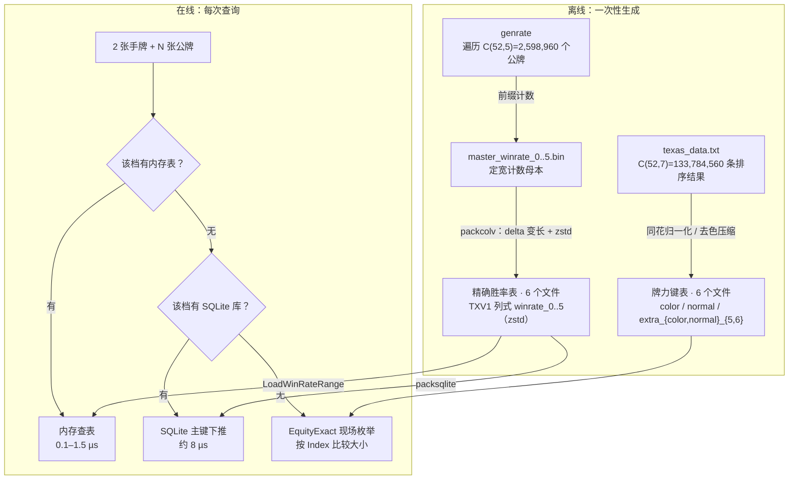
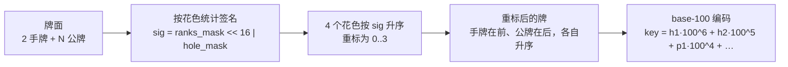
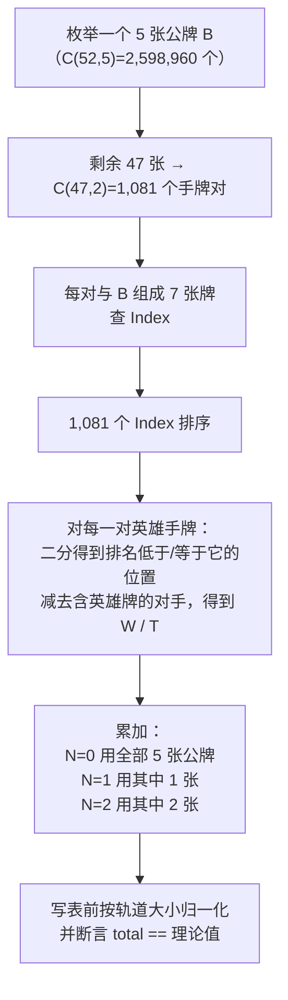

# 德州扑克算法

[](https://github.com/esrrhs/texas_algorithm)
[](https://github.com/esrrhs/texas_algorithm)
[](https://central.sonatype.com/artifact/com.github.esrrhs/texas_algorithm)
[](https://github.com/esrrhs/texas_algorithm/actions)
[](https://github.com/esrrhs/texas_algorithm/actions)
[](https://github.com/esrrhs/texas_algorithm/actions)

高性能德州扑克算法库，面向标准 52 张牌的德州扑克，提供 **Java**、**Go** 与 **C++** 三套功能对齐的实现，包含两个独立子系统：

| 子系统 | 数据体积 | 功能 |
|--------|----------|------|
| **牌力查表** | 约 23.7 MB | 5–7 张牌的最优 5 张、排名、牌型 |
| **胜率评估** | 44.9 MiB（zstd） | 2 张手牌 + 0–5 张公牌对随机对手的**精确** 1v1 胜率 |

## 数据包

数据表已直接提交到仓库根目录，无需下载或解压任何压缩包。12 个文件合计 **70,770,975 B ≈ 67.5 MiB**：

| 文件 | 行数 | 大小 | 作用 |
|------|------|------|------|
| `texas_data_color.txt` | — | 14,558,394 B | 同花类牌力键表 |
| `texas_data_normal.txt` | — | 5,037,969 B | 非同花牌力键表 |
| `texas_data_extra_color_5.txt` | — | 112,960 B | 5 张同花类辅助键表 |
| `texas_data_extra_color_6.txt` | — | 1,757,927 B | 6 张同花类辅助键表 |
| `texas_data_extra_normal_5.txt` | — | 533,409 B | 5 张非同花辅助键表 |
| `texas_data_extra_normal_6.txt` | — | 1,738,288 B | 6 张非同花辅助键表 |
| `texas_data_winrate_0.zst` | 169 | 1,547 B | 翻牌前精确胜率（计数） |
| `texas_data_winrate_1.zst` | 5,083 | 38,881 B | 1 张公牌精确胜率（计数） |
| `texas_data_winrate_2.zst` | 93,769 | 581,464 B | 2 张公牌精确胜率（计数） |
| `texas_data_winrate_3.zst` | 1,286,792 | 4,739,218 B | 翻牌精确胜率（计数） |
| `texas_data_winrate_4.zst` | 13,960,050 | 15,096,215 B | 转牌精确胜率（计数） |
| `texas_data_winrate_5.zst` | 123,156,254 | 26,574,703 B | 河牌精确胜率（计数） |

前 6 个文件供牌力查询使用，后 6 个文件供胜率查询使用，两者互不依赖：

- 只有 6 个牌力文件时，`Load()` 可用，`LoadProbility()` 会打印缺失提示但不会崩溃；`getHandProbability` 会回退到现场枚举（没有表可查），枚举本身依赖 `Index`。
- 只有 6 个胜率文件时，查表可用，但牌力查询与现场枚举不可用（它们依赖 `Index`）。

`.zst` 是 **TXV1 列式**数据：24 字节文件头（记录档位、行数、total）之后是三段互不交错的列——键的 delta 变长编码、全部 `win`、全部 `tie`——再整体用 zstd 压缩。`total` 不是统计量而是理论常数 `C(50-N, 5-N) × 990`，每档只存一次；`loss = total - win - tie` 从不落盘。键天然升序，delta + zstd 把 487 MB 的 N=5 解码数据压到 25.4 MiB。三语言都内置解码器（Go `klauspost/compress/zstd`、C++ 内置 zstd 解压单文件、Java aircompressor），用户无需手工解压。

所有加载函数都从**当前工作目录**读取数据表，因此请在仓库根目录运行，或把文件软链到你的目录：

```bash
ln -s /path/to/texas_algorithm/texas_data_*.* .
```

### 三种加载模式

三语言都按「该档有内存表 → 有 SQLite 库 → 现场枚举」的顺序取数，查询入口为 `GetHandProbability(cards)` / `getHandProbability(hand, pub)`。

**1. SQLite —— 开箱即用的低内存模式。** 打包库按主键下推查询，除页缓存外不把行读进堆：

```go
ta.Load()                                     // 牌力键表，其余 API 需要
ta.LoadSqlite("texas_data_winrate.db", 0, 5)  // 0–5 档按需查盘
```

```java
TexasAlgorithmUtil.load();
TexasAlgorithmUtil.loadSqlite(new File("texas_data_winrate.db"), 0, 5);
```

```cpp
Load();
LoadSqlite("texas_data_winrate.db", 0, 5);
```

数据库**不进 git**（2.34 GiB，约为 zstd 数据的 53 倍）。用 `cd go && go run ./cmd/packsqlite -dir .. -out ../texas_data_winrate.db` 本地生成，或从 release 附件获取。表结构为聚簇无二级索引的 `w{n}(k INTEGER PRIMARY KEY, w INTEGER, t INTEGER) WITHOUT ROWID`，一次查询只走一次 B 树。

**2. 大内存模式 —— 查询最快。** 把各档解码成紧凑数组（键 `int64` + win/tie `uint32`；N=4/5 同样用有序数组 + 二分，不用 map）：

```go
ta.LoadWinRateRange(0, 5)   // RSS +2.1 GiB，单次查询 0.1–1.5 µs
```

Java：`TexasAlgorithmUtil.loadWinRateRange(0, 5)`；C++：`LoadWinRateRange(0, 5)`。

**3. 小内存模式 —— 只在值得的地方建表。** 只加载低档，3–5 档现场枚举：

```go
ta.LoadWinRateRange(0, 2)   // RSS +1.2 MB；N=3 约 46 ms，N=4 约 2 ms，N=5 约 0.2 ms
```

实测环境：Apple M1 Pro，Go 1.27.3，干净进程，先加载牌力键表，每档取 100 个随机牌面的中位数：

| 模式 | 接口 | CPU：N=3 / N=5 | 内存 RSS 增量 | 磁盘 |
|------|------|----------------|---------------|------|
| SQLite | `LoadSqlite(db, 0, 5)` | 8.2 µs / 8.2 µs | +5.4 MB | 2.34 GiB `.db` + 44.9 MiB `.zst` |
| 大内存 | `LoadWinRateRange(0, 5)` | 0.7 µs / 1.5 µs | +2.1 GiB（其中 N=5 约 1.88 GiB） | 44.9 MiB `.zst` |
| 小内存 | `LoadWinRateRange(0, 2)` | 45.8 ms / 207 µs | +1.2 MB | 44.9 MiB `.zst` |

SQLite 逐档查询延迟中位数（N = 0…5）：4.5 / 4.6 / 8.0 / 8.2 / 10.0 / 8.2 µs。SQLite 换来的是内存和加载时间，**不是磁盘空间**：它的文件比 zstd 大一个数量级。依赖代价：Go 用 `modernc.org/sqlite`（纯 Go、无 cgo）；C++ 优先用系统 `libsqlite3`，找不到时由 CMake 下载固定版本的 amalgamation（见 [SQLite（可选）](#sqlite可选)）；Java 用 `org.xerial:sqlite-jdbc`（约 13 MB，内含各平台原生库，由 Maven 下载一次、运行时释放）。

默认策略保持克制：`LoadProbility()` 只加载 0–3 档。4/5 档不会被解码，除非显式按范围加载或打开 SQLite 库——它们解码后分别需要 223 MiB 和 1.88 GiB。

---

## 目录结构

```
java/    Java 实现（Maven，发布到 Maven Central）
go/      Go 实现（与 Java 库功能对齐的移植版本）
cpp/     C++ 实现（与 Java/Go 功能对齐，CMake 构建）
```

三套实现共用同一份数据表，输出逐位一致。

---

## Java

### Maven 依赖

```xml
<dependency>
    <groupId>com.github.esrrhs</groupId>
    <artifactId>texas_algorithm</artifactId>
    <version>1.0.14</version>
</dependency>
```

### 快速上手

```java
// 1. 加载牌力键表（约 23.7 MB，牌力查询与现场枚举必须先调用）
TexasAlgorithmUtil.load();

// 2. 加载 0–3 档精确胜率表（约 5.1 MB zstd 数据）；4/5 档默认现场枚举，
//    除非按范围加载或打开打包 SQLite 库
TexasAlgorithmUtil.loadProbility();

// 3. 最优 5 张牌
String best = TexasAlgorithmUtil.getMax("黑2,黑3", "方2,方A,黑7,黑5,红10");

// 4. 绝对排名与直接比较（数值越大越强；正数表示第一手赢）
int rank = TexasAlgorithmUtil.getWinPosition("方4,方A,红7,黑A,黑3,黑5,黑6");
int cmp  = TexasAlgorithmUtil.compare("方4,方A,红7,黑A,黑3,黑5,黑6",
                                      "黑2,红3,方7,梅9,方K,黑Q,红J");

// 5. 牌型常量
int type = TexasAlgorithmUtil.getWinType("方4,方A,红7,黑A,黑3,黑5,黑6");

// 6. 精确 1v1 胜率，返回 [0, 1]
float p = TexasAlgorithmUtil.getHandProbability("方3,黑6", "黑2,黑4,黑5,黑K");
```

所有接收牌面的方法都会校验 52 张牌编码；非法牌（例如花色大于 3 或点数不在 2..14 范围内）会抛 `IllegalArgumentException`。

---

## Go

### 安装

```bash
go get github.com/esrrhs/texas_algorithm/go
```

### 快速上手

```go
package main

import (
	"fmt"

	ta "github.com/esrrhs/texas_algorithm/go"
)

func main() {
	// 牌力键表（约 23.7 MB）
	ta.Load()

	// 0–3 档精确胜率表（约 5.1 MB zstd 数据）
	ta.LoadProbility()

	best, err := ta.GetMaxStrHandPub("黑2,黑3", "方2,方A,黑7,黑5,红10")
	if err != nil {
		panic(err)
	}
	fmt.Println(best)

	rank, _ := ta.GetWinPositionStr("方4,方A,红7,黑A,黑3,黑5,黑6")
	cmp, _ := ta.CompareStr("方4,方A,红7,黑A,黑3,黑5,黑6",
		"黑2,红3,方7,梅9,方K,黑Q,红J")
	typ, _ := ta.GetWinTypeStr("方4,方A,红7,黑A,黑3,黑5,黑6")

	p, err := ta.GetHandProbabilityStr("方3,黑6", "黑2,黑4,黑5,黑K")
	if err != nil {
		panic(err)
	}

	_, _, _, _ = rank, cmp, typ, p
}
```

Go API 与 Java 一一对应：`Load`/`LoadDir` ↔ `load()`、`GetKeyData*` ↔ `getKeyData()`、`GetMax*` ↔ `getMax()`、`GetWin*` ↔ `getWin*()`、`Compare*` ↔ `compare()`、`GetHandProbability*` ↔ `getHandProbability()`。非法牌会返回包装了 `ErrUnknownPoke` 的 `error`；胜率表缺失不算错误，查询会现场枚举（需要先 `Load()`）。

---

## C++

### 构建

```bash
cd cpp
cmake -S . -B build -DCMAKE_BUILD_TYPE=Release
cmake --build build --parallel
```

需要 C++17 编译器和 CMake 3.16+。

### SQLite（可选）

只有查询打包的 `.db` 才需要 SQLite，其余功能不带它也能构建。用 `-DTEXAS_SQLITE=<模式>` 选择获取方式：

| 模式 | 行为 |
|------|------|
| `auto`（默认） | 有系统 SQLite 就用系统库，没有则下载固定版本的 3.45.1 amalgamation |
| `system` | 只用系统库；找不到就关闭 SQLite 支持 |
| `fetch` | 强制下载固定版本的 amalgamation |
| `off` | 完全不编译 SQLite 支持 |

下载固定为 `sqlite-amalgamation-3450100.zip` 并校验 SHA256，压缩包缓存到构建目录的 `_deps/` 下，因此**只有找不到系统库时，首次 configure 才需要联网**。离线或受限环境可以装系统库（`apt install libsqlite3-dev`、`brew install sqlite`），或者直接 `-DTEXAS_SQLITE=off`。

没启用 SQLite 也不会让构建失败：`LoadSqlite` 照常可编译可链接，调用时打印 `本构建未启用 SQLite 支持，请用 -DTEXAS_SQLITE=fetch 重新配置` 并返回 false，查询自动回退到现场枚举。`IsSqliteSupported()` 可以判断当前构建是哪一种。

### 快速上手

```cpp
#include "texas_algorithm_util.h"

using namespace texas_algorithm;

int main()
{
    Load();            // 牌力键表（约 23.7 MB）
    LoadProbility();   // 0–3 档精确胜率表（约 5.1 MB zstd 数据）

    std::string best = GetMaxStrHandPub("黑2,黑3", "方2,方A,黑7,黑5,红10");
    int rank = GetWinPositionStr("方4,方A,红7,黑A,黑3,黑5,黑6");
    int cmp  = CompareStr("方4,方A,红7,黑A,黑3,黑5,黑6",
                          "黑2,红3,方7,梅9,方K,黑Q,红J");
    int type = GetWinTypeStr("方4,方A,红7,黑A,黑3,黑5,黑6");

    float p = GetHandProbabilityStr("方3,黑6", "黑2,黑4,黑5,黑K");
}
```

链接 `texas_algorithm` 库目标即可。非法牌抛 `std::invalid_argument`；胜率表缺失不算错误，查询会现场枚举（需要先 `Load()`）。

---

## 牌面表示

牌面用中文字符串表示，多张牌用英文逗号分隔。

### 花色

| 表示 | 花色 |
|------|------|
| `方` | ♦ 方块 |
| `梅` | ♣ 梅花 |
| `红` | ♥ 红心 |
| `黑` | ♠ 黑桃 |

### 点数

`2` `3` `4` `5` `6` `7` `8` `9` `10` `J` `Q` `K` `A`

每张牌编码为一个字节 `(color << 4) | value`：`color` 为 0..3（`方`=0、`梅`=1、`红`=2、`黑`=3），`value` 为 2..14（`J`=11、`Q`=12、`K`=13、`A`=14）。牌堆共 52 张，其他任何字节都会被拒绝。

---

## 牌型说明

`getWinType()` 返回整型常量（Go：`TexasCardType*`；C++：`texas_algorithm` 命名空间中的同名常量；取值相同）：

| 常量 | 值 | 牌型 |
|------|----|------|
| `TEXAS_CARD_TYPE_GAOPAI` | 1 | 高牌 |
| `TEXAS_CARD_TYPE_DUIZI` | 2 | 对子 |
| `TEXAS_CARD_TYPE_LIANGDUI` | 3 | 两对 |
| `TEXAS_CARD_TYPE_SANTIAO` | 4 | 三条 |
| `TEXAS_CARD_TYPE_SHUNZI` | 5 | 顺子 |
| `TEXAS_CARD_TYPE_TONGHUA` | 6 | 同花 |
| `TEXAS_CARD_TYPE_HULU` | 7 | 葫芦 |
| `TEXAS_CARD_TYPE_SITIAO` | 8 | 四条 |
| `TEXAS_CARD_TYPE_TONGHUASHUN` | 9 | 同花顺 |
| `TEXAS_CARD_TYPE_KINGTONGHUASHUN` | 10 | 皇家同花顺 |

---

## API 参考

### `TexasAlgorithmUtil`（Java）

```java
// 加载 / 初始化
void load()                                   // 加载牌力键表（默认当前目录）
void load(String dirPath)                     // 从指定目录加载牌力键表
void load(File dir)
void loadProbility()                          // 加载 0–3 档精确胜率表（默认当前目录）
void loadProbility(String dirPath)
void loadProbility(File dir)
void loadProbilityAll(File dir)               // 加载全部 6 档（约 2.1 GiB）
void loadWinRateRange(int from, int to)       // 加载 from..to 档到内存
void loadWinRateRange(File dir, int from, int to)
void loadSqlite(File db, int from, int to)    // 按需查 from..to 档
boolean isLoaded()                            // 牌力键表是否已加载
boolean isProbabilityLoaded()                 // 已加载档位是否存在

// 最优手牌
String getMax(String hand, String pub)        // 2 张手牌 + 3–5 张公牌中的最优 5 张
String getMax(String cards)                   // 5–7 张牌中的最优 5 张

// 牌力评估（需先 load()）
int    getWinPosition(String cards)           // 绝对排名
double getWinProbability(String cards)        // 相对同规模全部组合的胜率比例
int    getWinType(String cards)               // 牌型常量
long   getWinMax(String cards)                // 最优 5 张牌的编码 key
int    compare(String str1, String str2)      // 比较两手 7 张牌

// 精确胜率：内存表 → SQLite → 现场枚举；枚举回退需要 load()
float  getHandProbability(String hand, String pub)
```

### Go / C++ 对应接口

| Java | Go / C++ |
|------|----------|
| `load()` / `load(dir)` | `Load()` / `LoadDir(dir)` |
| `loadProbility()` / `loadProbility(dir)` | `LoadProbility()` / `LoadProbilityDir(dir)` |
| `loadProbilityAll(dir)` | `LoadProbilityAll(dir)` |
| `loadWinRateRange(from, to)` | `LoadWinRateRange(from, to)` |
| `loadWinRateRange(dir, from, to)` | `LoadWinRateRangeDir(dir, from, to)` |
| `loadSqlite(db, from, to)` | `LoadSqlite(path, from, to)` |
| `isLoaded()` / `isProbabilityLoaded()` | `IsLoaded()` / `IsProbabilityLoaded()` |
| `getMax(hand, pub)` | `GetMaxStrHandPub(hand, pub)` |
| `getMax(cards)` | `GetMaxStr(cards)` / `GetMax(pokes)` |
| `getWinPosition(cards)` | `GetWinPositionStr(cards)` / `GetWinPosition(pokes)` |
| `getWinProbability(cards)` | `GetWinProbabilityStr(cards)` / `GetWinProbability(pokes)` |
| `getWinType(cards)` | `GetWinTypeStr(cards)` / `GetWinType(pokes)` |
| `getWinMax(cards)` | `GetWinMaxStr(cards)` / `GetWinMax(pokes)` |
| `compare(str1, str2)` | `CompareStr(str1, str2)` / `CompareBytes(a, b)` / `CompareKey(k1, k2)` |
| `getHandProbability(hand, pub)` | `GetHandProbabilityStr(hand, pub)` / `GetHandProbability(hand, pub)` |

---

## 运行单元测试

```bash
# Java：JUnit 5（支持 Java 8、11、17、21）
cd java && mvn test

# Go
cd go && go test ./...

# C++（CMake/ctest）
cd cpp && cmake -S . -B build && cmake --build build && ctest --test-dir build --output-on-failure
```

依赖数据表的用例在数据文件缺失时自动跳过；SQLite 用例还要求本地生成过 `texas_data_winrate.db`（该文件不进仓库）。

---

## 重新生成数据表

牌力键表与胜率表是两条独立的生成流水线。

### 1. 牌力键表

1. 确保数据表位于工作目录（数据表随仓库放在根目录，可直接在仓库根目录运行，或把它们软链到你的目录）。
2. Java：加 `-Xmx8000m`（约 8 GB 堆）后运行 `TexasAlgorithmUtil.main()`；Go：在 `go/` 运行 `go run ./cmd/texas_algorithm`；C++：在 `cpp/` 运行 `./build/texas_algorithm_demo`。
3. 10 核机器约需 **7–8 小时**。

### 2. 精确胜率表

```bash
cd go
# 1. 遍历公牌，写出 master_winrate_N.bin（定宽，每行 16 字节）
go run ./cmd/genrate -workers 10 -ckpt genrate.ckpt -out .

# 2. 把母本编码成 TXV1 列式数据并用 zstd 压缩
go run ./cmd/packcolv -dir ..

# 3. 可选：把 6 档数据打包成一个按需查询的 SQLite 库
go run ./cmd/packsqlite -dir .. -out ../texas_data_winrate.db

# 4. 可选：交叉验证六档表是不是全的（数键，不读 win/tie）
go run ./cmd/genrate -mode expect -maxN 5 -out ..
```

- `-workers`：并发数，默认 `NumCPU`
- `-ckpt`：断点文件；checkpoint 带版本号，版本不匹配会自动忽略并重新开始
- `-resume=false`：忽略已有断点
- `-mode smoke` / `-maxE`：小规模自检
- `-mode count`：只解码 `.zst` 校验格式并数行，**抓不到生成时漏键**
- `-mode expect`：独立推导每档应有的键数，再与解码行数逐档比对，不一致直接报「哪一档、期望多少、实际多少」。
  - 0–4 档走**真实牌面暴力枚举 + 去重**（`CanonKey` 后丢进 set 数个数）：0–2 档不到 1 秒，3 档约 3 秒，4 档约 1 分钟 / 390 MB（默认 `-bruteN 4`；`-bruteN 3` 约 6 秒）
  - 5 档（123M 键、2.8B 种牌面）默认用**签名多重集的 Burnside 闭式计数**（毫秒级）；`-bruteN 5` 全暴力实测约 20 分钟、峰值 RSS 5.7 GB
  - 能证明：表里恰好是本该有的全部键，没有漏也没有多；`formula` 档还与 `brute` 档在 0–5 档互相对上
  - 不能证明：键定义（`CanonKey`）本身正确——formula 与 brute 都以它为定义；也不校验 win/tie 数值和 total

Apple M1 Pro（10 核）/ 10 并发：**18 分 04 秒**，约 3.0 CPU·小时。`packcolv` 每列各扫一遍母本，因此 N=5 打包时内存占用保持平稳。`packsqlite` 按档位可断点续做：先写 `texas_data_winrate.db.tmp`，全部档位完成后才原子改名，崩溃不会留下半个可被误用的库；相同输入产生逐字节相同的输出。

---

## 算法详解

### 总览



一句话概括：**牌力键表负责「这把牌有多强」，胜率表负责「这张牌面赢多少」；前者是后者的底座，后者按需覆盖全部街道，默认只覆盖翻牌前到翻牌圈。**

---

### 一、离线怎么算

#### 1.1 牌力键表（`color` / `normal` / `extra_*`）

**问题**：给定 5–7 张牌，它在这副牌的全部同规模组合里排第几？

**做法**：

1. 枚举 C(52,7) = 133,784,560 种 7 张组合，每种的编码 key 与「7 选 5 后的最大牌面」对齐。
2. 按牌力排序，得到每个 key 的 `Index`（排名序号）、`Max`（最优 5 张的 key）与 `Type`（牌型）。
3. 直接保存 1.3 亿条会撑爆内存，所以按花色冗余压缩：
   - **同花类**（同花、同花顺、皇家同花顺）：至少 5 张同花色，把花色分布归一化为 `♦♦♦♦♦♣♠`，写入 `texas_data_color.txt`。
   - **非同花类**：花色不影响牌力，全部折叠成 `♦`，写入 `texas_data_normal.txt`。
   - `extra_{color,normal}_{5,6}` 是 5 张 / 6 张规模的同类辅助表。
4. 查询时两表都查，取排名更高者。

这一步与胜率无关，只提供胜率枚举所需的 `Index` 比较基准。

#### 1.2 精确胜率表（`winrate_0` … `winrate_5`）

**存储内容**：每一种「2 张手牌 + N 张已知公牌」（N = 0…5）对一名随机对手的**完整枚举计数**：

```
<key> <win> <tie>        （total 只存在文件头一次）
```

- `key`：花色规范化键（见 1.3）
- `win` / `tie`：英雄手牌严格领先 / 打平的对手手牌数
- `total`：该情形的枚举总数，等于 `C(50-N, 5-N) × 990`

`total` 不是一个可变的统计量，而是一个**理论常量**，所以每档只存一次，`loss = total - win - tie` 从不落盘：

| 表 | 行数 | 每行 total | 数值 |
|----|------|-----------|------|
| `winrate_0` | 169 | C(50,5) × 990 | 2,097,572,400 |
| `winrate_1` | 5,083 | C(49,4) × 990 | 209,757,240 |
| `winrate_2` | 93,769 | C(48,3) × 990 | 17,123,040 |
| `winrate_3` | 1,286,792 | C(47,2) × 990 | 1,070,190 |
| `winrate_4` | 13,960,050 | C(46,1) × 990 | 45,540 |
| `winrate_5` | 123,156,254 | C(45,0) × 990 | 990 |

**编码**：TXV1 是列式而非行式。24 字节文件头（`"TXV1"`、档位、行数、total）之后是三段互不交错的列——键的 delta 变长、全部 `win`、全部 `tie`——再整体 zstd 压缩。键天然升序，delta 很小；487 MB 的 N=5 解码数据最终压到 25.4 MiB。三语言都内置解码器，无需手工解压。

#### 1.3 键编码：花色置换归约 + 角色区分

一张牌编码为 `(花色 << 4) | 点数`。键的构造分三步：



- **签名** `sig = ranks_mask << 16 | hole_mask`：这个花色里出现了哪些点数，其中哪些是手牌。
- **按签名重标花色**：对任意一个花色置换，4 个签名的多重集不变，因此排序后得到的重标方案只差一个「同签名花色之间的顺序」。而同签名的两个花色所持的 `(点数, 角色)` 集合完全相同，交换它们不改变重标后的牌面，所以键唯一。
- **手牌在前、公牌在后**：`hole_mask` 参与签名，且两类牌在键里占用不同位置，因此「A♠K♠ 手牌 + Q♠ 公牌」与「A♠ 手牌 + K♠Q♠ 公牌」不会撞键。

#### 1.4 为什么归约是严格的，不是近似

关键事实：**全局重标花色是游戏的自同构**——它保持每张牌的点数、保持「是否同花」这一等价关系，因此任意 7 张牌的牌力、任意两手牌的胜负关系都不变。

于是：

- 同一轨道内的所有物理情形，其 W/T/L **完全相同**（不是相近，是逐位相同）。
- `CanonKey` 是轨道上的完全不变式：两个情形键相同 ⇔ 它们在同一轨道。
- 所以「按 key 聚合」只是把同一组数字加了 `|orbit|` 次，再除回去，结果与逐情形枚举逐位一致。

这个性质在生成器里被写成断言，而不是靠人相信：

```go
mult := v.N / base[n]              // 轨道大小
if v.W%mult != 0 || v.T%mult != 0 { // 同一轨道内必须均匀
    panic("counts are not orbit-uniform")
}
```

只要某个轨道不是均匀的，或者有公牌组合被漏枚举，`v.N % base[n] != 0` 会立刻 panic。

#### 1.5 行数从哪来

| 表 | 物理情形数 | 轨道数（= 行数） | 压缩比 |
|----|-----------|-----------------|--------|
| N = 0 | C(52,2) = 1,326 | **169** | 7.8× |
| N = 1 | 1,326 × 50 = 66,300 | **5,083** | 13.0× |
| N = 2 | 1,326 × C(50,2) = 1,624,350 | **93,769** | 17.3× |
| N = 3 | 1,326 × C(50,3) = 25,989,600 | **1,286,792** | 20.2× |
| N = 4 | 1,326 × C(50,4) = 305,377,800 | **13,960,050** | 21.9× |
| N = 5 | 1,326 × C(50,5) = 2,809,475,760 | **123,156,254** | 22.8× |

- **169** 有闭式解：13 个对子 + 78 个同花 + 78 个非同花，即经典起手牌分类数。
- 其余是 `(2 手牌 + N 公牌)` 在 24 阶花色置换群下的轨道数，没有简单的闭式；它们等于生成器实际产出的不同 `CanonKey` 个数，可以直接用输出行数核对。

#### 1.6 生成器：单趟遍历 + 前缀计数

朴素做法是「每个情形 × 每个公牌补全 × 990 个对手」，总量约 2.8×10¹² 次比牌，不可行。生成器把顺序倒过来：



设英雄手牌为 `i,j`，对手必须是剩下的 45 张里的 2 张，共 **C(45,2) = 990** 个。设 `lo` / `hi` 为排序数组中 `Index < hero` 与 `Index ≤ hero` 的位置，`la` / `lb` 为含牌 `i` / `j` 且排名低于英雄的对手数，`ea` / `eb` 同理为相等者，则：

```
win  = lo - la - lb
tie  = (hi - lo) - (ea + eb - 1)   // -1 是英雄自己（两张单牌列表各数了一次）
loss = 990 - win - tie
```

这就是「恰好含一张手牌」的对手组合被排除在分母外的具体实现。

**为什么一趟能出六张表**：一个 5 张公牌 `B` 同时是它的全部前缀——N=0 时是完整公牌，N=1 时是 5 个单张前缀之一，一直到 N=5 的整块公牌。前缀正好是 `C(5,N)` 个子集，所以每个 1,081 手牌对的结果会被累加 `2^5 = 32` 次：`Σ C(5,N) = 1+5+10+10+5+1 = 32`，分别进入六张表。全部 2,598,960 × 1,081 个「公牌 × 手牌对」跑完，六张表的计数自然齐了。

**工程细节**：

- **并行**：按「最大牌下标 e」切分任务，`-workers` 控制并发，各 worker 本地累加后合并。
- **断点续跑**：每完成一个 e 落盘一次 checkpoint（gob，含 `ckptVer`），版本号不一致的断点会被忽略。
- **确定性**：合并是整数加法（可交换），输出按 key 升序，因此无论线程如何调度，输出字节完全一致（sha256 已核对）。
- **进度**：每个 e 打印已完成公牌数、百分比与 ETA。

#### 1.7 耗时与产物

| 项目 | 数值 |
|------|------|
| 遍历规模 | 2,598,960 个公牌 × 1,081 个手牌对 |
| 耗时（M1 Pro，10 并发） | 18 分 04 秒（约 3.0 CPU·小时） |
| N=5 解码后 payload | 487,590,054 B |
| `winrate_0.zst` | 169 行 / 1,547 B |
| `winrate_1.zst` | 5,083 行 / 38,881 B |
| `winrate_2.zst` | 93,769 行 / 581,464 B |
| `winrate_3.zst` | 1,286,792 行 / 4,739,218 B |
| `winrate_4.zst` | 13,960,050 行 / 15,096,215 B |
| `winrate_5.zst` | 123,156,254 行 / 26,574,703 B |
| 总体积 | 47,025,828 B ≈ 44.9 MiB |

#### 1.8 校验手段

1. **结构断言**：每行 `total` 必须等于理论枚举次数，否则 panic（抓漏枚举、抓过期 checkpoint）。
2. **均匀性断言**：`W % orbit == 0 && T % orbit == 0`（抓错误的轨道归约）。
3. **与独立暴力实现对齐**：另写一份不使用 `Index`、直接两两比牌力的枚举器，对随机样本逐位对比 float32 结果——N=2 抽 200 例、N=1 抽 3 例、N=0 抽 1 例，全部逐位相同。
4. **跨语言对齐**：Go 与 C++ 在 N=0..5 的 13 个用例上输出逐位相同。

---

### 二、在线怎么算

#### 2.1 查表（N ≤ 3 默认，4–5 可选）

```text
key = CanonKey(手牌 ++ 公牌, nHole = 2)
row = WinRateMap[N][key]          // 或打包的 SQLite 库
P   = (2·win + tie) / (2·total)
```

`LoadProbility()` 默认加载 0–3 档；4/5 档或 SQLite 库中的任意档在加载后走同一条路径。内存表是有序键数组 + 平行的 `win`/`tie` 数组（二分查找，不用 map）；SQLite 是 `WITHOUT ROWID` 主键下推。实测单次查询中位数：内存 **0.1–0.7 µs**，SQLite **4.5–10 µs**。

#### 2.2 现场枚举（N ≥ 4 默认）

该档既没有内存表也没有 SQLite 库时，`EquityExact` 枚举所有剩余公牌补全 × 990 个对手：

| N | 公牌补全数 | 对手数 | 比牌次数 | 延迟（M1 Pro） |
|---|-----------|--------|---------|---------------|
| 3（翻牌） | C(47,2) = 1,081 | 990 | 1,070,190 | 45.8 ms（多线程） |
| 4（转牌） | C(46,1) = 46 | 990 | 45,540 | 2.0 ms（多线程） |
| 5（河牌） | 1 | 990 | 990 | 207 µs（单线程） |

比大小的依据是牌力键表的 `Index`，不重算牌型：`Index` 大者赢，相等者平。

#### 2.3 990 的来历

固定英雄的 2 张手牌后，对手只能从剩余 50 张里取 2 张；但其中包含英雄手牌的 91 种组合是非法的（`46 + 46 - 1`），所以：

```
C(50,2) - 91 = 1225 - 91 = 990 = C(45,2)
```

现场枚举时，公牌补全会进一步消耗牌张，但「对手只能从扣掉英雄手牌与全部已知公牌后的 45 张里取 2 张」这一点不变，因此每一档的对手数恒为 990。

#### 2.4 平局算半胜

```text
P(胜) = (W + 0.5·T) / (W + T + L) = (2W + T) / (2(W + T + L))
```

实现上全程用整数计数，最后一次 `float64 → float32` 舍入，误差 ≤ 1 ulp（相对 1.2×10⁻⁷），不存在累积误差。

#### 2.5 默认分界点为什么是 3

六档表都存在且精确，但每多一档，建表成本和常驻内存都成倍增长：

| N | 轨道数（= 行数） | 按 16 B/行解码后的内存（键 int64 + win/tie uint32） | 建表比牌数 |
|---|-----------------|---------------------------------------------------|-----------|
| 3 | 1,286,792 | 约 21 MB | 2.6×10⁷ 情形 × 1,070,190 ≈ 2.8×10¹³ |
| 4 | 13,960,050 | 约 223 MB | 3.1×10⁸ × 45,540 ≈ 1.4×10¹³ |
| 5 | 123,156,254 | 约 1.88 GiB | 2.8×10⁹ × 990 ≈ 2.8×10¹² |

按 50 ns/次估算，N=4 一张表就要约 **8 天机时**，而同样的 N=4 情形现场只要 2.0 ms。**预计算比现场计算贵几个数量级，多出来的 2 GB 还会一直常驻**，因此默认只加载 0–3 档。上三档仍然可用：河牌密集的负载可以 `LoadWinRateRange(0, 5)` 全量进内存，或 `LoadSqlite(db, 0, 5)` 以约 8 µs 的延迟按需查库、保持堆占用平稳。

---

### 三、三语言一致性

| 项目 | Go | C++ | Java |
|------|----|-----|------|
| 精确算法实现 | ✅ 已跑测试 | ✅ 已跑测试 | ✅ `mvn test` 12/12 |
| 表格式 / CanonKey | ✅ | ✅ | ✅ |
| SQLite 路径 | ✅ 与打包库对拍 | ✅ 与打包库对拍 | ✅ 与打包库对拍 |
| 误差与延迟数据 | ✅ 实测 | 复用 Go 的表与算法 | 复用 Go 的表与算法 |

Go、C++、Java 三套测试都覆盖 N=0..5、内存表、SQLite 回退及其范围限制。SQLite 用例需要本地生成的 `texas_data_winrate.db`，缺失时自动跳过；CI 可以先生成一次或把它作为构建产物挂上去。

---

## 相关项目

- [majiang_algorithm](https://github.com/esrrhs/majiang_algorithm) — 麻将算法
- [teenpatti_algorithm](https://github.com/esrrhs/teenpatti_algorithm) — 印度炸金花算法
