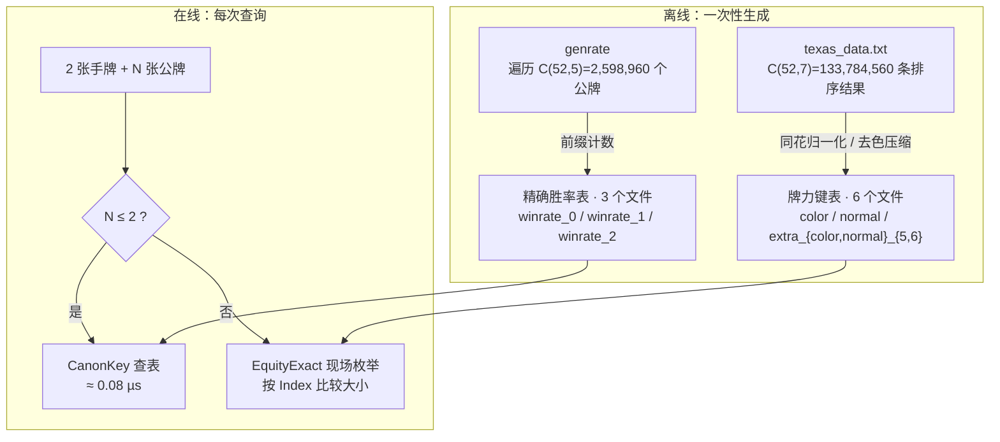
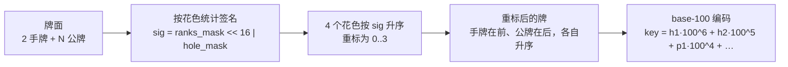
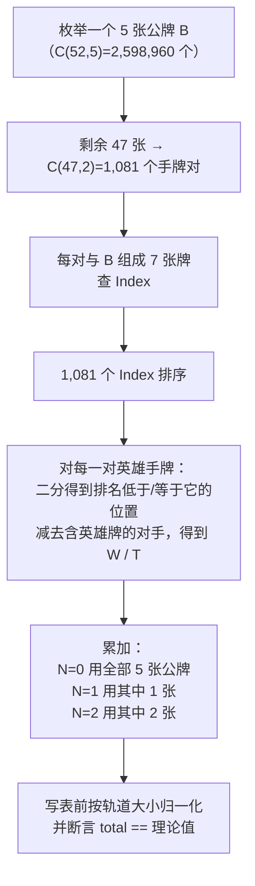

# 德州扑克算法

[](https://github.com/esrrhs/texas_algorithm)
[](https://github.com/esrrhs/texas_algorithm)
[](https://central.sonatype.com/artifact/com.github.esrrhs/texas_algorithm)
[](https://github.com/esrrhs/texas_algorithm/actions)
[](https://github.com/esrrhs/texas_algorithm/actions)
[](https://github.com/esrrhs/texas_algorithm/actions)

高性能德州扑克算法库，面向标准 52 张牌的德州扑克，提供 **Java**、**Go** 与 **C++** 三套功能对齐的实现，包含两个独立子系统：

| 子系统 | 内存占用 | 功能 |
|--------|----------|------|
| **牌力查表** | 约 20 MB | 5–7 张牌的最优 5 张、排名、牌型 |
| **胜率评估** | 约 4.7 MB | 2 张手牌 + 0–5 张公牌对随机对手的**精确** 1v1 胜率 |

## 破坏性变更（54 张 → 52 张）

鬼牌 / 万能牌支持已移除。基于旧版 54 张牌 API 编写的代码需要做以下调整：

- **鬼牌输入会被拒绝。** 牌堆为标准 52 张；鬼牌（`鬼`，字节 88 / 花色 5）以及 `"鬼"` 字符串解析分支已删除，传入 `"鬼"` 或原始字节 88 都会校验失败。合法牌为花色 0..3、点数 2..14。
- **不再返回鬼牌替换信息。** `getMax` / `getMaxStrHandPub` / `getMaxHandPub` 不再返回或接收第二个 `guiTrans` 值：Go 返回 `(best, error)`，Java 与 C++ 只返回最优牌面。`FiveFromSeven` / `FiveFromSix` / `FiveFromFive` 鬼牌包装函数已删除，仅保留 `...WithoutGui` 核心函数。
- **非法输入改为报错，不再返回零值。** `getKeyData`、`getWinPosition`、`getWinProbability`、`getWinMax`、`getWinType`、`compare*` 与 `getHandProbability` 遇到非法牌时会拒绝：Go 返回 `error`（`ErrUnknownPoke`，消息以 `无法识别的牌` 开头），Java 抛 `IllegalArgumentException`，C++ 抛 `std::invalid_argument`。
- **数据表按 C(52,7) = 133,784,560 重新生成。** 牌力键表改为枚举 52 张牌中的 7 张组合，而非 C(54,7)。
- **旧的插值胜率表 `texas_data_opt_2..6.txt` 已彻底移除。** 精确胜率改由 `texas_data_winrate_0..2.txt` 提供，`GetHandProbabilityKey`（Java：`getHandProbability(long)`）一并删除。数据包从 11 个文件减到 9 个，体积从 348.4 MiB 降到 25.8 MiB。

## 数据包

数据表已直接提交到仓库根目录，无需下载或解压任何压缩包。9 个文件合计 **27,051,640 B ≈ 25.8 MiB**：

| 文件 | 行数 | 大小 | 作用 |
|------|------|------|------|
| `texas_data_color.txt` | — | 14,558,394 B | 同花类牌力键表 |
| `texas_data_normal.txt` | — | 5,037,969 B | 非同花牌力键表 |
| `texas_data_extra_color_5.txt` | — | 112,960 B | 5 张同花类辅助键表 |
| `texas_data_extra_color_6.txt` | — | 1,757,927 B | 6 张同花类辅助键表 |
| `texas_data_extra_normal_5.txt` | — | 533,409 B | 5 张非同花辅助键表 |
| `texas_data_extra_normal_6.txt` | — | 1,738,288 B | 6 张非同花辅助键表 |
| `texas_data_winrate_0.txt` | 169 | 6,060 B | 翻牌前精确胜率（计数） |
| `texas_data_winrate_1.txt` | 5,083 | 176,806 B | 1 张公牌精确胜率（计数） |
| `texas_data_winrate_2.txt` | 93,769 | 3,129,827 B | 2 张公牌精确胜率（计数） |

前 6 个文件供牌力查询使用，后 3 个文件供胜率查询使用，两者互不依赖：

- 只有前 6 个文件时，`Load()` 可用，`LoadProbility()` 会打印缺失提示但不会崩溃；`getHandProbability` 在 N ≥ 3 时仍可现场枚举，N ≤ 2 时抛/返回「缺少胜率表数据」。
- 只有后 3 个文件时，胜率查询可用，但牌力查询与现场枚举不可用（它们依赖 `Index`）。

所有加载函数都从**当前工作目录**读取数据表，因此请在仓库根目录运行，或把文件软链到你的目录：

```bash
ln -s /path/to/texas_algorithm/texas_data_*.txt .
```

若在意克隆体积，可在本地保留 gzip 压缩版（`gzip -9 texas_data_*.txt`，9 个文件合计约 3.0 MiB），需要跑表时再解压。

---

## 目录结构

```
java/    Java 实现（Maven，发布到 Maven Central）
go/      Go 实现（与 Java 库功能对齐的移植版本）
cpp/     C++ 实现（与 Java/Go 功能对齐，CMake 构建）
```

三套实现共用同一份数据表，输出逐位一致；Go 与 C++ 已与 Java 版本做过位级对照。

---

## Java

### Maven 依赖

```xml
<dependency>
    <groupId>com.github.esrrhs</groupId>
    <artifactId>texas_algorithm</artifactId>
    <version>1.0.14</version>
</dependency>
```

### 快速上手

```java
// 1. 加载牌力键表（约 20 MB，牌力查询与现场枚举必须先调用）
TexasAlgorithmUtil.load();

// 2. 加载精确胜率表（约 4.7 MB，只有 N ≤ 2 的查表路径需要）
TexasAlgorithmUtil.loadProbility();

// 3. 最优 5 张牌
String best = TexasAlgorithmUtil.getMax("黑2,黑3", "方2,方A,黑7,黑5,红10");

// 4. 绝对排名与直接比较（数值越大越强；正数表示第一手赢）
int rank = TexasAlgorithmUtil.getWinPosition("方4,方A,红7,黑A,黑3,黑5,黑6");
int cmp  = TexasAlgorithmUtil.compare("方4,方A,红7,黑A,黑3,黑5,黑6",
                                      "黑2,红3,方7,梅9,方K,黑Q,红J");

// 5. 牌型常量
int type = TexasAlgorithmUtil.getWinType("方4,方A,红7,黑A,黑3,黑5,黑6");

// 6. 精确 1v1 胜率，返回 [0, 1]
float p = TexasAlgorithmUtil.getHandProbability("方3,黑6", "黑2,黑4,黑5,黑K");
```

所有接收牌面的方法都会校验 52 张牌编码；非法牌（例如 `鬼`、字节 88、花色大于 3 或点数不在 2..14 范围内）会抛 `IllegalArgumentException`。

---

## Go

### 安装

```bash
go get github.com/esrrhs/texas_algorithm/go
```

### 快速上手

```go
package main

import (
	"fmt"

	ta "github.com/esrrhs/texas_algorithm/go"
)

func main() {
	// 牌力键表（约 20 MB）
	ta.Load()

	// 精确胜率表（约 4.7 MB）
	ta.LoadProbility()

	best, err := ta.GetMaxStrHandPub("黑2,黑3", "方2,方A,黑7,黑5,红10")
	if err != nil {
		panic(err)
	}
	fmt.Println(best)

	rank, _ := ta.GetWinPositionStr("方4,方A,红7,黑A,黑3,黑5,黑6")
	cmp, _ := ta.CompareStr("方4,方A,红7,黑A,黑3,黑5,黑6",
		"黑2,红3,方7,梅9,方K,黑Q,红J")
	typ, _ := ta.GetWinTypeStr("方4,方A,红7,黑A,黑3,黑5,黑6")

	p, err := ta.GetHandProbabilityStr("方3,黑6", "黑2,黑4,黑5,黑K")
	if err != nil {
		panic(err)
	}

	_, _, _, _ = rank, cmp, typ, p
}
```

Go API 与 Java 一一对应：`Load`/`LoadDir` ↔ `load()`、`GetKeyData*` ↔ `getKeyData()`、`GetMax*` ↔ `getMax()`、`GetWin*` ↔ `getWin*()`、`Compare*` ↔ `compare()`、`GetHandProbability*` ↔ `getHandProbability()`。非法牌会返回包装了 `ErrUnknownPoke` 的 `error`；胜率表缺失时 `GetHandProbability` 返回 `ErrNoProbabilityData`。

---

## C++

### 构建

```bash
cd cpp
cmake -S . -B build -DCMAKE_BUILD_TYPE=Release
cmake --build build --parallel
```

需要 C++17 编译器和 CMake 3.16+。

### 快速上手

```cpp
#include "texas_algorithm_util.h"

using namespace texas_algorithm;

int main()
{
    Load();            // 牌力键表（约 20 MB）
    LoadProbility();   // 精确胜率表（约 4.7 MB）

    std::string best = GetMaxStrHandPub("黑2,黑3", "方2,方A,黑7,黑5,红10");
    int rank = GetWinPositionStr("方4,方A,红7,黑A,黑3,黑5,黑6");
    int cmp  = CompareStr("方4,方A,红7,黑A,黑3,黑5,黑6",
                          "黑2,红3,方7,梅9,方K,黑Q,红J");
    int type = GetWinTypeStr("方4,方A,红7,黑A,黑3,黑5,黑6");

    float p = GetHandProbabilityStr("方3,黑6", "黑2,黑4,黑5,黑K");
}
```

链接 `texas_algorithm` 库目标即可。非法牌抛 `std::invalid_argument`；胜率表缺失时同样抛 `std::invalid_argument("缺少胜率表数据")`。

---

## 牌面表示

牌面用中文字符串表示，多张牌用英文逗号分隔。

### 花色

| 表示 | 花色 |
|------|------|
| `方` | ♦ 方块 |
| `梅` | ♣ 梅花 |
| `红` | ♥ 红心 |
| `黑` | ♠ 黑桃 |

### 点数

`2` `3` `4` `5` `6` `7` `8` `9` `10` `J` `Q` `K` `A`

每张牌编码为一个字节 `(color << 4) | value`：`color` 为 0..3（`方`=0、`梅`=1、`红`=2、`黑`=3），`value` 为 2..14（`J`=11、`Q`=12、`K`=13、`A`=14）。牌堆共 52 张，其他任何字节（包括已删除的鬼牌字节 88 / 花色 5）都会被拒绝。

---

## 牌型说明

`getWinType()` 返回整型常量（Go：`TexasCardType*`；C++：`texas_algorithm` 命名空间中的同名常量；取值相同）：

| 常量 | 值 | 牌型 |
|------|----|------|
| `TEXAS_CARD_TYPE_GAOPAI` | 1 | 高牌 |
| `TEXAS_CARD_TYPE_DUIZI` | 2 | 对子 |
| `TEXAS_CARD_TYPE_LIANGDUI` | 3 | 两对 |
| `TEXAS_CARD_TYPE_SANTIAO` | 4 | 三条 |
| `TEXAS_CARD_TYPE_SHUNZI` | 5 | 顺子 |
| `TEXAS_CARD_TYPE_TONGHUA` | 6 | 同花 |
| `TEXAS_CARD_TYPE_HULU` | 7 | 葫芦 |
| `TEXAS_CARD_TYPE_SITIAO` | 8 | 四条 |
| `TEXAS_CARD_TYPE_TONGHUASHUN` | 9 | 同花顺 |
| `TEXAS_CARD_TYPE_KINGTONGHUASHUN` | 10 | 皇家同花顺 |

---

## API 参考

### `TexasAlgorithmUtil`（Java）

```java
// 加载 / 初始化
void load()                                   // 加载牌力键表（默认当前目录）
void load(String dirPath)                     // 从指定目录加载牌力键表
void load(File dir)
void loadProbility()                          // 加载 3 张精确胜率表（默认当前目录）
void loadProbility(String dirPath)
void loadProbility(File dir)
boolean isLoaded()                            // 牌力键表是否已加载
boolean isProbabilityLoaded()                 // 3 张胜率表是否全部加载

// 最优手牌
String getMax(String hand, String pub)        // 2 张手牌 + 3–5 张公牌中的最优 5 张
String getMax(String cards)                   // 5–7 张牌中的最优 5 张

// 牌力评估（需先 load()）
int    getWinPosition(String cards)           // 绝对排名
double getWinProbability(String cards)        // 相对同规模全部组合的胜率比例
int    getWinType(String cards)               // 牌型常量
long   getWinMax(String cards)                // 最优 5 张牌的编码 key
int    compare(String str1, String str2)      // 比较两手 7 张牌

// 精确胜率（需先 loadProbility()，N ≥ 3 时还需要 load()）
float  getHandProbability(String hand, String pub)
```

### Go / C++ 对应接口

| Java | Go / C++ |
|------|----------|
| `load()` / `load(dir)` | `Load()` / `LoadDir(dir)` |
| `loadProbility()` / `loadProbility(dir)` | `LoadProbility()` / `LoadProbilityDir(dir)` |
| `isLoaded()` / `isProbabilityLoaded()` | `IsLoaded()` / `IsProbabilityLoaded()` |
| `getMax(hand, pub)` | `GetMaxStrHandPub(hand, pub)` |
| `getMax(cards)` | `GetMaxStr(cards)` / `GetMax(pokes)` |
| `getWinPosition(cards)` | `GetWinPositionStr(cards)` / `GetWinPosition(pokes)` |
| `getWinProbability(cards)` | `GetWinProbabilityStr(cards)` / `GetWinProbability(pokes)` |
| `getWinType(cards)` | `GetWinTypeStr(cards)` / `GetWinType(pokes)` |
| `getWinMax(cards)` | `GetWinMaxStr(cards)` / `GetWinMax(pokes)` |
| `compare(str1, str2)` | `CompareStr(str1, str2)` / `CompareBytes(a, b)` / `CompareKey(k1, k2)` |
| `getHandProbability(hand, pub)` | `GetHandProbabilityStr(hand, pub)` / `GetHandProbability(hand, pub)` |

---

## 运行单元测试

```bash
# Java：JUnit 5（支持 Java 8、11、17、21）
cd java && mvn test

# Go
cd go && go test ./...

# C++（CMake/ctest）
cd cpp && cmake -S . -B build && cmake --build build && ctest --test-dir build --output-on-failure
```

依赖数据表的用例在数据文件缺失时自动跳过（CI 上没有数据文件）。

---

## 重新生成数据表

牌力键表与胜率表是两条独立的生成流水线。

### 1. 牌力键表

1. 确保数据表位于工作目录（数据表随仓库放在根目录，可直接在仓库根目录运行，或把它们软链到你的目录）。
2. Java：加 `-Xmx8000m`（约 8 GB 堆）后运行 `TexasAlgorithmUtil.main()`；Go：在 `go/` 运行 `go run ./cmd/texas_algorithm`；C++：在 `cpp/` 运行 `./build/texas_algorithm_demo`。
3. 10 核机器约需 **7–8 小时**。

> 旧的 `genTrans` / `genTransOpt` 步骤会生成 `texas_data_2..6.txt` 与 `texas_data_opt_2..6.txt`。它们只服务于已删除的插值胜率算法，**不再是运行期数据包的一部分**。

### 2. 精确胜率表

```bash
cd go
go run ./cmd/genrate -workers 10 -ckpt genrate.ckpt -out .
```

- `-workers`：并发数，默认 `NumCPU`
- `-ckpt`：断点文件；checkpoint 带版本号，版本不匹配会自动忽略并重新开始
- `-resume=false`：忽略已有断点
- `-mode smoke` / `-maxE`：小规模自检

Apple M1 Pro（10 核）/ 10 并发：**18 分 04 秒**，约 3.0 CPU·小时。

---

## 算法详解

### 总览



一句话概括：**牌力键表负责「这把牌有多强」，胜率表负责「这张牌面赢多少」；前者是后者的底座，后者只覆盖翻牌前到翻牌圈。**

---

### 一、离线怎么算

#### 1.1 牌力键表（`color` / `normal` / `extra_*`）

**问题**：给定 5–7 张牌，它在这副牌的全部同规模组合里排第几？

**做法**：

1. 枚举 C(52,7) = 133,784,560 种 7 张组合，每种的编码 key 与「7 选 5 后的最大牌面」对齐。
2. 按牌力排序，得到每个 key 的 `Index`（排名序号）、`Max`（最优 5 张的 key）与 `Type`（牌型）。
3. 直接保存 1.3 亿条会撑爆内存，所以按花色冗余压缩：
   - **同花类**（同花、同花顺、皇家同花顺）：至少 5 张同花色，把花色分布归一化为 `♦♦♦♦♦♣♠`，写入 `texas_data_color.txt`。
   - **非同花类**：花色不影响牌力，全部折叠成 `♦`，写入 `texas_data_normal.txt`。
   - `extra_{color,normal}_{5,6}` 是 5 张 / 6 张规模的同类辅助表。
4. 查询时两表都查，取排名更高者。

这一步与胜率无关，只提供胜率枚举所需的 `Index` 比较基准。

#### 1.2 精确胜率表（`winrate_0` / `winrate_1` / `winrate_2`）

**存储内容**：每一种「2 张手牌 + N 张已知公牌」（N = 0/1/2）对一名随机对手的**完整枚举计数**：

```
<key> <win> <tie> <total>
```

- `key`：花色规范化键（见 1.3）
- `win` / `tie`：英雄手牌严格领先 / 打平的对手手牌数
- `total`：该情形的枚举总数，等于 `C(50-N, 5-N) × 990`

`total` 不是一个可变的统计量，而是一个**理论常量**：

| 表 | 每行 total | 数值 |
|----|-----------|------|
| `winrate_0` | C(50,5) × 990 | 2,097,572,400 |
| `winrate_1` | C(49,4) × 990 | 209,757,240 |
| `winrate_2` | C(48,3) × 990 | 17,123,040 |

#### 1.3 键编码：花色置换归约 + 角色区分

一张牌编码为 `(花色 << 4) | 点数`。键的构造分三步：



- **签名** `sig = ranks_mask << 16 | hole_mask`：这个花色里出现了哪些点数，其中哪些是手牌。
- **按签名重标花色**：对任意一个花色置换，4 个签名的多重集不变，因此排序后得到的重标方案只差一个「同签名花色之间的顺序」。而同签名的两个花色所持的 `(点数, 角色)` 集合完全相同，交换它们不改变重标后的牌面，所以键唯一。
- **手牌在前、公牌在后**：`hole_mask` 参与签名，且两类牌在键里占用不同位置，因此「A♠K♠ 手牌 + Q♠ 公牌」与「A♠ 手牌 + K♠Q♠ 公牌」不会撞键。

#### 1.4 为什么归约是严格的，不是近似

关键事实：**全局重标花色是游戏的自同构**——它保持每张牌的点数、保持「是否同花」这一等价关系，因此任意 7 张牌的牌力、任意两手牌的胜负关系都不变。

于是：

- 同一轨道内的所有物理情形，其 W/T/L **完全相同**（不是相近，是逐位相同）。
- `CanonKey` 是轨道上的完全不变式：两个情形键相同 ⇔ 它们在同一轨道。
- 所以「按 key 聚合」只是把同一组数字加了 `|orbit|` 次，再除回去，结果与逐情形枚举逐位一致。

这个性质在生成器里被写成断言，而不是靠人相信：

```go
mult := v.N / base[n]              // 轨道大小
if v.W%mult != 0 || v.T%mult != 0 { // 同一轨道内必须均匀
    panic("counts are not orbit-uniform")
}
```

只要某个轨道不是均匀的，或者有公牌组合被漏枚举，`v.N % base[n] != 0` 会立刻 panic。

#### 1.5 169 / 5,083 / 93,769 从哪来

| 表 | 物理情形数 | 轨道数（= 行数） | 压缩比 |
|----|-----------|-----------------|--------|
| N = 0 | C(52,2) = 1,326 | **169** | 7.8× |
| N = 1 | 1,326 × 50 = 66,300 | **5,083** | 13.0× |
| N = 2 | 1,326 × C(50,2) = 1,624,350 | **93,769** | 17.3× |

- **169** 有闭式解：13 个对子 + 78 个同花 + 78 个非同花，即经典起手牌分类数。
- **5,083** 与 **93,769** 是 `(2 手牌 + 1 公牌)`、`(2 手牌 + 2 公牌)` 在 24 阶花色置换群下的轨道数，没有简单的闭式；它们等于生成器实际产出的不同 `CanonKey` 个数，可以直接用输出行数核对。

#### 1.6 生成器：单趟遍历 + 前缀计数

朴素做法是「每个情形 × 每个公牌补全 × 990 个对手」，总量约 2.8×10¹² 次比牌，不可行。生成器把顺序倒过来：



设英雄手牌为 `i,j`，对手必须是剩下的 45 张里的 2 张，共 **C(45,2) = 990** 个。设 `lo` / `hi` 为排序数组中 `Index < hero` 与 `Index ≤ hero` 的位置，`la` / `lb` 为含牌 `i` / `j` 且排名低于英雄的对手数，`ea` / `eb` 同理为相等者，则：

```
win  = lo - la - lb
tie  = (hi - lo) - (ea + eb - 1)   // -1 是英雄自己（两张单牌列表各数了一次）
loss = 990 - win - tie
```

这就是「恰好含一张手牌」的对手组合被排除在分母外的具体实现。

**为什么一趟能出三张表**：一个 5 张公牌 `B` 同时是
- N=0 的完整公牌（1 次），
- N=1 时「已知 1 张 + 未知 4 张」的一个样本（5 次），
- N=2 时「已知 2 张 + 未知 3 张」的一个样本（C(5,2) = 10 次）。

所以每个 1,081 手牌对的结果会被累加 1 + 5 + 10 = 16 次，分别进入三张表。全部 2,598,960 × 1,081 个「公牌 × 手牌对」跑完，三张表的计数自然齐了。

**工程细节**：

- **并行**：按「最大牌下标 e」切分任务，`-workers` 控制并发，各 worker 本地累加后合并。
- **断点续跑**：每完成一个 e 落盘一次 checkpoint（gob，含 `ckptVer`）。版本号不一致的旧断点会被忽略——这曾经导致过一次真实的污染事故：旧的键方案会把 121 个幽灵键写进表里。
- **确定性**：合并是整数加法（可交换），输出按 key 升序，因此无论线程如何调度，输出字节完全一致（sha256 已核对）。
- **进度**：每个 e 打印已完成公牌数、百分比与 ETA。

#### 1.7 耗时与产物

| 项目 | 数值 |
|------|------|
| 遍历规模 | 2,598,960 个公牌 × 1,081 个手牌对 |
| 耗时（M1 Pro，10 并发） | 18 分 04 秒（约 3.0 CPU·小时） |
| `winrate_0` | 169 行 / 6,060 B |
| `winrate_1` | 5,083 行 / 176,806 B |
| `winrate_2` | 93,769 行 / 3,129,827 B |

#### 1.8 校验手段

1. **结构断言**：每行 `total` 必须等于理论枚举次数，否则 panic（抓漏枚举、抓过期 checkpoint）。
2. **均匀性断言**：`W % orbit == 0 && T % orbit == 0`（抓错误的轨道归约）。
3. **与独立暴力实现对齐**：另写一份不使用 `Index`、直接两两比牌力的枚举器，对随机样本逐位对比 float32 结果——N=2 抽 200 例、N=1 抽 3 例、N=0 抽 1 例，全部逐位相同。
4. **跨语言对齐**：Go 与 C++ 在 N=0..5 的 13 个用例上输出逐位相同。

---

### 二、在线怎么算

#### 2.1 N ≤ 2：查表

```text
key = CanonKey(手牌 ++ 公牌, nHole = 2)
row = WinRateMap[N][key]
P   = (2·win + tie) / (2·total)
```

一次哈希查找，热态约 **0.07–0.08 µs**。

#### 2.2 N ≥ 3：现场精确枚举

`EquityExact` 枚举所有剩余公牌补全 × 990 个对手：

| N | 公牌补全数 | 对手数 | 比牌次数 | 延迟（M1 Pro） |
|---|-----------|--------|---------|---------------|
| 3（翻牌） | C(47,2) = 1,081 | 990 | 1,070,190 | 47.4 ms（多线程） |
| 4（转牌） | C(46,1) = 46 | 990 | 45,540 | 2.25 ms（多线程） |
| 5（河牌） | 1 | 990 | 990 | 164 µs（单线程） |

比大小的依据是牌力键表的 `Index`，不再重算牌型：`Index` 大者赢，相等者平。

#### 2.3 990 的来历

固定英雄的 2 张手牌后，对手只能从剩余 50 张里取 2 张；但其中包含英雄手牌的 91 种组合是非法的（`46 + 46 - 1`），所以：

```
C(50,2) - 91 = 1225 - 91 = 990 = C(45,2)
```

现场枚举时，公牌补全会进一步消耗牌张，但「对手只能从扣掉英雄手牌与全部已知公牌后的 45 张里取 2 张」这一点不变，因此每一档的对手数恒为 990。

#### 2.4 平局算半胜

```text
P(胜) = (W + 0.5·T) / (W + T + L) = (2W + T) / (2(W + T + L))
```

实现上全程用整数计数，最后一次 `float64 → float32` 舍入，误差 ≤ 1 ulp（相对 1.2×10⁻⁷），不存在累积误差。

#### 2.5 分界点为什么是 2

如果把 N ≥ 3 也做成查表，条目数是 `C(52,2) × C(50,N)`：

| N | 物理情形数 | 建表所需比牌数（× 单情形枚举量） |
|---|-----------|--------------------------------|
| 3 | 25,989,600 | 2.6×10⁷ × 1,070,190 ≈ 2.8×10¹³ |
| 4 | 305,377,800 | 3.1×10⁸ × 45,540 ≈ 1.4×10¹³ |
| 5 | 2,809,475,760 | 2.8×10⁹ × 990 ≈ 2.8×10¹² |

按 50 ns/次估算，N=4 一张表就要约 **8 天机时**，而同样的 N=4 情形现场只要 45,540 次比牌、2.25 ms。**建表成本比现场计算高 9 个数量级，查表收益为零**，因此分界点取 N=2：往下的三档查询频率最高、单次枚举量最大，值得预计算；往上的三档枚举量已经足够小。

---

### 三、为什么换掉旧的插值算法

旧实现把胜率表示成「牌力键 → 统计量」的映射：`texas_data_opt_2..6.txt` 每行是 `key type avg min max`，查询时用公牌表（P1）与「手牌 + 公牌」表（P2）的 `avg/min/max` 做线性插值。

问题有两个：

1. **映射本身不是线性的。** 牌力排名到胜率是强非线性、且依赖具体牌面结构（听牌、阻断牌、对手范围）的关系。
2. **表里存的是分桶统计，不是逐情形计数。** 插值只能在这两者之间猜。

以精确枚举为真值，随机抽样得到的误差（百分点）：

| N | 样本 | 平均 \|Δ\| | p95 \|Δ\| | 最大 \|Δ\| |
|---|------|-----------|----------|-----------|
| 0（翻牌前） | 300 | 5.31 | 10.34 | 11.18 |
| 1 | 300 | 6.10 | 12.85 | 14.72 |
| 2 | 300 | 6.56 | 13.34 | 18.70 |
| 3（翻牌） | 300 | 6.85 | 14.13 | 19.86 |
| 4（转牌） | 500 | 7.31 | 17.04 | 26.87 |

**平均偏 5–7 个百分点，最坏接近 27 个百分点**，并不是旧文档声称的「≤ 0.10」。这个量级的误差足以让「跟注 / 弃牌」的决策反转，所以整个插值方案被移除：

- 删除 `texas_data_opt_2..6.txt`（旧包的 92.6% 体积）与 `GetHandProbabilityKey`。
- N ≤ 2 改为精确计数表，N ≥ 3 改为现场精确枚举。
- 数据包 348.4 MiB → **25.8 MiB**（−92.6%）。

---

### 四、三语言一致性

| 项目 | Go | C++ | Java |
|------|----|-----|------|
| 精确算法实现 | ✅ 已跑测试 | ✅ 已跑测试 | ⚠️ 已同步代码，本机无 JDK，**未编译验证** |
| 表格式 / CanonKey | ✅ | ✅ | ✅（静态对齐） |
| 误差与延迟数据 | ✅ 实测 | 复用 Go 的表与算法 | — |

Go 与 C++ 的测试覆盖 N=0..5 的全部路径；Java 侧改动为机械同步（删除 `ProbilityData` / `probilityMap` / `optprobilityMap` / `getHandProbability(long)`，`loadProbility` 改为只加载 3 张 winrate 表），但**尚未在 JVM 上运行过**。

---

## 相关项目

- [majiang_algorithm](https://github.com/esrrhs/majiang_algorithm) — 麻将算法
- [teenpatti_algorithm](https://github.com/esrrhs/teenpatti_algorithm) — 印度炸金花算法
